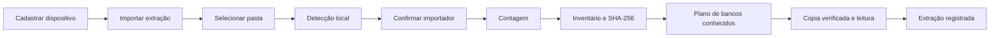
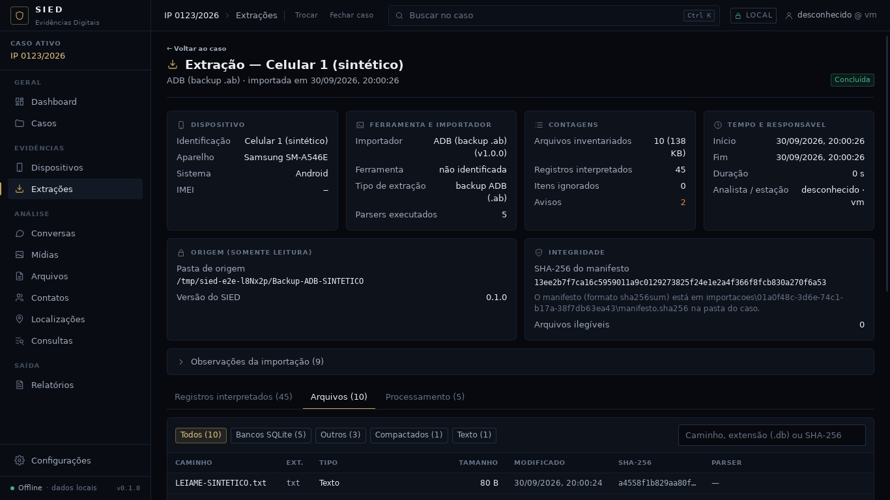

# Importação de extrações no SIED

> Estado verificado na `main` em 08/10/2026, commit `d2c33cac99c83e3b97c00120c4f1443d9e30150c`.
> Este guia descreve o comportamento existente. Não é uma promessa de suporte a formatos ainda não implementados.

## Visão rápida

A importação atual é um fluxo local e assíncrono. O analista escolhe um dispositivo já cadastrado e uma pasta de extração; o SIED detecta os importadores compatíveis, pede a confirmação do analista e executa o pipeline sem gravar na origem.

### Regra visual antes da importação

Enquanto não houver **um dispositivo cadastrado e pelo menos uma extração concluída**, o SIED mantém uma preparação central e contida:

- não exibe a sidebar do workspace;
- não exibe painéis laterais de alertas ou auditoria;
- não exibe Dashboard nem módulos analíticos;
- apresenta somente a identificação do caso, a sequência de liberação e as etapas **Dispositivo** e **Extração**;
- abre o workspace automaticamente somente depois que a importação termina com estado `concluída`.

A **Auditoria** possui aba própria na sidebar e só aparece junto com o workspace já liberado. Ela não faz parte do Dashboard nem da preparação inicial.

## Como iniciar

1. Abra ou crie um caso.
2. Cadastre o dispositivo examinado.
3. Em **Extrações**, clique em **Importar extração**.
4. Escolha o dispositivo ao qual a extração pertence.
5. Cole o caminho ou use **Escolher...** para selecionar a pasta da extração.
6. Confira a ferramenta detectada, o nível de suporte e os motivos apresentados.
7. Selecione um importador disponível e clique em **Iniciar importação**.

> A captura antiga do assistente foi removida deste guia porque mostrava a sidebar e o painel de Auditoria antes da liberação do workspace. Esse arranjo não representa a interface atual.

## O que o assistente confere

- A pasta é aberta por uma fonte restrita a leitura.
- Todos os importadores registrados analisam a estrutura rapidamente.
- As opções são ordenadas por suporte e confiança.
- A escolha final continua sob controle do analista.
- Importadores não implementados ou que não reconhecem a fonte ficam indisponíveis.
- Só uma importação pode ficar em andamento por vez.

## As quatro etapas reais

### 1. Contagem

Conta arquivos e bytes para apresentar progresso medido. Nenhuma porcentagem fictícia é criada.

### 2. Inventário e SHA-256

Lê cada arquivo, identifica sua categoria pela assinatura, calcula SHA-256 e registra o inventário. Ao mesmo tempo, gera `manifesto.sha256` dentro da pasta do caso.

### 3. Bancos conhecidos

O importador selecionado monta o plano de processamento: quais bancos ou arquivos conhecidos serão enviados a quais parsers. Arquivos sem parser continuam preservados no inventário.

### 4. Cópia verificada e leitura

Cada banco necessário é copiado para a área de trabalho do caso. A cópia é conferida contra o SHA-256 do inventário antes de o parser ler. Arquivos SQLite auxiliares `-wal` e `-journal` são tratados quando existem. Os registros interpretados mantêm a referência técnica até arquivo, tabela, registro, consulta, parser e versão.

## Acompanhamento em tempo real

O painel apresenta:

- etapa atual e barra de progresso;
- arquivos e bytes processados;
- bancos interpretados;
- registros e avisos;
- tempo decorrido, taxa medida e estimativa apenas quando existem dados suficientes;
- item atual;
- botão de cancelamento;
- console de eventos reais emitidos pelo backend.

O console registra contagem, inventário, hashes, bancos localizados, cópias conferidas, parsers executados, avisos, erros e o resultado final. Ele pode ser reaberto depois na aba **Processamento** da extração.

Durante a execução, o console permanece dentro da preparação central. Sidebar, Dashboard, alertas laterais e Auditoria continuam ocultos até a conclusão real.

## Importadores existentes

| Importador | Situação atual | Conteúdo interpretado |
|---|---|---|
| Pasta genérica | Disponível com suporte parcial | Inventário completo; SMS/MMS, WhatsApp, contatos/chamadas Android, SMS iOS, históricos Chrome/Firefox/Safari, Telegram JSON e `.eml` quando o esquema/formato é reconhecido |
| ADB (`.ab`) | Disponível | Backup Android não cifrado, incluindo itens internos; backup cifrado permanece apenas inventariado |
| IPED | Disponível | Lista de itens CSV mantida pelo IPED e bancos conhecidos exportados fora da pasta interna `iped/` |
| ALEAPP / iLEAPP | Disponível | Exportações `_TSV Exports`; demais produtos do relatório permanecem inventariados |
| Avilla Forensics | Ainda não implementado | Aguarda uma árvore real e autorizada de extração; o SIED não inventa caminhos ou formatos |

## Resultados produzidos

Dentro da pasta do caso, a importação mantém:

- inventário de todos os arquivos e seus metadados;
- SHA-256 dos arquivos legíveis;
- `manifesto.sha256`;
- `log-importacao.jsonl`;
- cópias de trabalho verificadas usadas pelos parsers;
- execuções dos parsers, avisos e registros interpretados;
- estado final `concluída`, `cancelada` ou `falhou`;
- eventos de início e fim na trilha de auditoria.

## Garantias forenses preservadas

- A pasta original da extração é somente leitura.
- O SIED nunca altera os arquivos originais.
- Parsers leem cópias verificadas, não o banco original diretamente.
- Um arquivo ilegível gera registro/aviso; não recebe hash inventado.
- Dados implausíveis permanecem como foram lidos e não viram fatos presumidos.
- Cancelar interrompe cooperativamente o pipeline e registra o resultado real.
- Falhas não são convertidas em sucesso e permanecem visíveis no console.

## Depois da importação

Use **Abrir extração** para conferir resumo, arquivos, registros, parsers, avisos, manifesto e console. Quando existe pelo menos uma extração concluída, o SIED libera o workspace analítico completo com Dashboard, Conversas, Busca, Mídias, Arquivos, Contatos, Localizações, Relatórios e Auditoria.

Somente nesse momento a sidebar aparece. A Auditoria fica disponível em sua própria rota/aba e não é incorporada ao Dashboard.

## Limitações atuais importantes

- Avilla continua propositalmente indisponível até existir uma estrutura real autorizada para implementação e teste.
- Backups ADB cifrados não são descriptografados automaticamente.
- Índice Lucene e bancos internos privados do IPED não são interpretados; usa-se o formato de troca suportado.
- ALEAPP/iLEAPP dependem das exportações TSV para gerar registros interpretados.
- RCS, bases de contatos do iOS, formatos proprietários de e-mail e extensões avançadas do WhatsApp ainda ficam no inventário até existir contrato/amostra suficiente.
- Nem todo arquivo inventariado possui parser; permanecer no inventário é diferente de ter o conteúdo interpretado.
- A velocidade depende do volume, disco, quantidade de hashes e bancos. O SIED mostra medidas reais, não um prazo fixo.

## Teste sem dados reais

O repositório possui geradores e fixtures exclusivamente sintéticos em `testes/`. Para uma demonstração manual, gere uma extração sintética e use o mesmo botão **Importar extração**. Nunca use uma extração real apenas para experimentar a interface.
