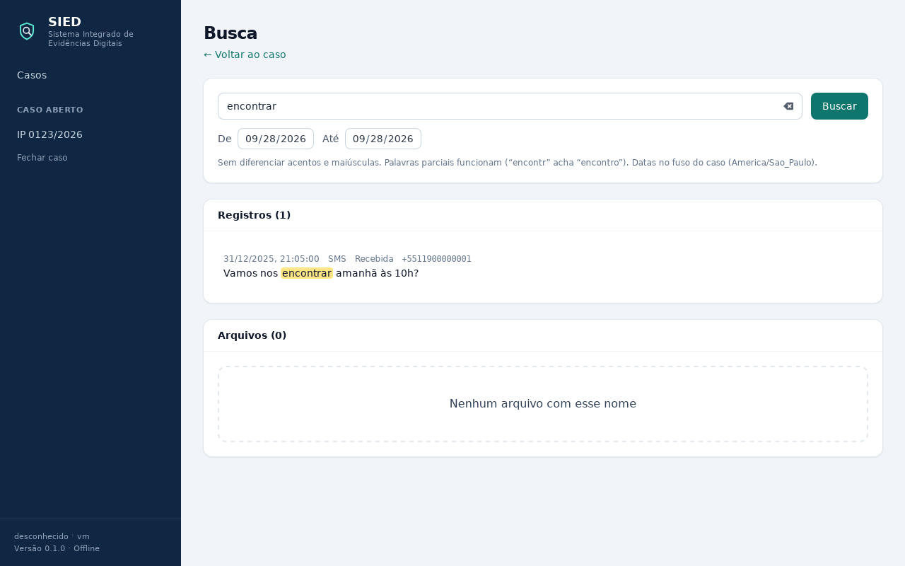
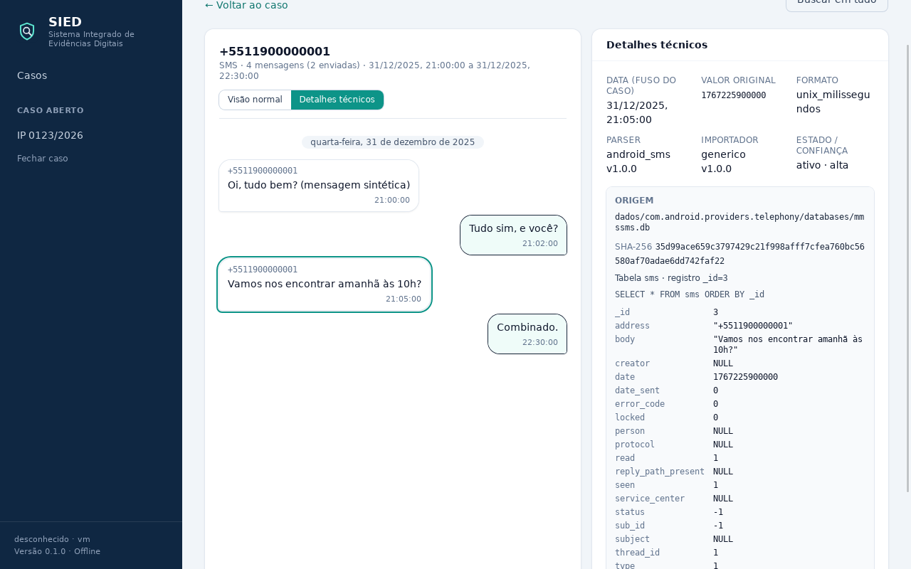

# Preparação da próxima etapa: Avilla e WhatsApp

Branch `fase1-preparacao`, 28/09/2026. Este documento separa **o que já foi preparado** (e não
depende de nenhuma extração real) do **que só pode ser feito com a amostra do Avilla**.

Regra seguida: nada aqui presume a organização de pastas, os nomes de arquivos ou as opções do
Avilla Forensics. Onde o Avilla aparece, é para listar perguntas, não respostas.

---

## 1. O que esta branch entrega

| Item | Onde | Depende do Avilla? |
|---|---|---|
| Conversas reconstruídas (derivadas dos registros) | migração 3, `sied-armazenamento/src/conversas.rs`, tela Conversas | Não |
| Busca global FTS5 (registros e nomes de arquivo) | migração 3, `sied-armazenamento/src/busca.rs`, tela Busca | Não |
| "Abrir na conversa" a partir da busca, com o registro destacado e a visão técnica aberta | `PaginaBusca.tsx`, `PaginaConversas.tsx` | Não |
| Roteiro do importador Avilla (este documento, §2) | aqui | É o que falta |
| Plano do parser WhatsApp Android (§3) | aqui | Não (o parser lê o banco do app, não a pasta do Avilla) |

Telas (extração sintética, teste ponta a ponta no app real):





### Testes

- Rust: 110 (11 novos). Conversas reconstruídas, busca por texto, prefixo sem acento, telefone em
  outro formato, nomes de arquivo, texto com sintaxe de FTS, filtros, e caso da versão 2 que ganha
  conversas e índice ao abrir (com cópia de segurança `antes-v3`).
- Interface: 15 (6 novos). Chat com lados, separadores por dia e hora no fuso do caso, alternância
  para a visão técnica, destaque do termo, link da busca para a conversa.
- Ponta a ponta no app real: passo novo "buscar, abrir na conversa e ver a origem", busca por
  telefone e lista de conversas; a pasta da extração continua intacta.

### Decisões desta branch (pequenas e reversíveis)

1. **Conversa é derivada.** A arquitetura previa `artefato.conversa_id` apontando para `conversa`.
   Mantivemos o artefato como está (com `conversa_id_externo`, o id da conversa no próprio app) e
   criamos `conversa` como agregação mantida por gatilho. Motivo: o artefato é somente inclusão e
   não precisa ser reescrito; a conversa pode ser reconstruída a qualquer momento a partir dele.
2. **`pessoa` fica para o WhatsApp.** Nomes de contato só aparecem com `wa.db` (e, depois, com os
   contatos do Android). Até lá, a conversa mostra os identificadores exatamente como o parser leu.
3. **Busca protegida contra sintaxe.** O texto digitado nunca vai cru para o FTS5: cada palavra vira
   uma frase com prefixo. Aspas, `OR`, `NEAR`, hífens não mudam o sentido nem causam erro.
4. **Telefone.** Um texto só com dígitos e separadores é buscado pelos dígitos em qualquer posição de
   remetente e destinatários, porque o mesmo número aparece com e sem DDI/DDD conforme o app.

### Limitações conhecidas

- A conversa carrega 500 mensagens por página. Vindo da busca, o registro é destacado se estiver na
  página carregada; em conversas maiores, a primeira página abre e o registro aparece na visão técnica.
- A busca ordena por relevância (FTS5 `rank`); não há ainda ordenação escolhida pelo analista.
- Filtros por app e tipo existem no backend, mas a tela só expõe extração e período (hoje só há SMS).

---

## 2. Importador do Avilla: o que falta e como será feito

### 2.1 O que precisamos do usuário (bloqueia só o importador Avilla)

1. **Árvore de pastas** de uma extração, de preferência de um aparelho de teste. No Windows, dentro
   da pasta da extração:

   ```
   tree /F /A > arvore.txt
   ```

   Só nomes de pastas e arquivos. Nenhum conteúdo.
2. **Versão do Avilla** usada (Sobre / título da janela).
3. **Opções marcadas** na extração, por exemplo: backup ADB, downgrade do APK do WhatsApp, cópia de
   pastas do armazenamento, extração de apps específicos, geração de relatório/hash pelo próprio Avilla.
4. Se o Avilla gera **arquivo de hash ou log** da aquisição, o nome dele (para o SIED conferir o
   "hash declarado", já previsto na arquitetura).
5. Se possível, uma **segunda árvore** de outra extração (outra versão ou outras opções), para que o
   importador não dependa de um único caso.

### 2.2 Como a árvore vira importador (processo, sem presumir o conteúdo)

1. Registrar a árvore recebida em `docs/avilla/` como amostra, **sem dados** (só nomes).
2. Identificar na árvore:
   - marcadores que permitem **detectar** que a pasta é do Avilla (e com que confiança);
   - onde ficam os bancos que os parsers já conhecem (`mmssms.db`, e depois `msgstore.db`/`wa.db`);
   - contêineres (`.ab`, `.tar`, `.zip`) e se são o formato principal: se forem, a leitura de contêiner
     entra antes do importador;
   - arquivos de metadados do próprio Avilla (versão, data, aparelho), que viram atributos detectados
     do dispositivo, com fonte.
3. Escrever o `ImportadorAvilla` sobre o contrato que já existe (`detectar` + `planejar`), com
   **fixture sintética gerada a partir da árvore real** (mesmos nomes, conteúdo inventado e marcado
   como sintético).
4. Testes obrigatórios antes de considerar pronto: detecção positiva e negativa, plano com os papéis
   certos, pasta de origem intacta (hash e datas antes/depois), e importação completa no app real.

### 2.3 O que já está pronto e o importador vai só usar

- Fonte somente leitura, inventário com SHA-256, manifesto, cópia de trabalho verificada.
- Execução em segundo plano com progresso, cancelamento e registro de interrupção.
- Parser de SMS; conversas e busca passam a valer automaticamente para o que o Avilla trouxer.

---

## 3. Parser WhatsApp Android: plano

O parser lê o banco do aplicativo, então vale para Avilla, pasta genérica ou qualquer importador
que encontre os arquivos. Os papéis serão:

| Papel | Arquivo | Obrigatório |
|---|---|---|
| `msgstore` | `msgstore.db` (+ `-wal`) | sim |
| `wa` | `wa.db` (+ `-wal`) | não (sem ele, sem nomes) |

### 3.1 Esquemas a suportar

O WhatsApp mudou o esquema do `msgstore.db` ao longo das versões. O parser **detecta pelo esquema**
(tabelas e colunas presentes), nunca pela versão do app, e registra qual variante leu.

- **Esquema antigo**: tabela `messages` (uma linha por mensagem, com `key_remote_jid`,
  `key_from_me`, `key_id`, `data`, `timestamp`, `remote_resource`, colunas de mídia).
- **Esquema novo**: `message` (com `chat_row_id`, `from_me`, `key_id`, `sender_jid_row_id`,
  `timestamp`, `text_data`, `message_type`), `chat`, `jid`, e tabelas auxiliares como
  `message_media`, `message_quoted`, `message_location`.
- `wa.db`: `wa_contacts` (jid, nome exibido, número).

Os nomes acima são a referência pública do aplicativo e **serão validados** com bancos sintéticos
gerados em teste e, depois, com um banco real de aparelho de teste. Coluna esperada ausente vira
aviso do parser (como no SMS), nunca registro inventado.

### 3.2 O que o parser vai emitir

- Mensagens (texto, mídia, localização, contato compartilhado, sistema), com `conversa_id_externo` =
  jid da conversa, remetente, `de_mim`, data original e formato, resposta e encaminhamento.
- Grupos e participantes, e a tabela `pessoa` com os nomes vindos de `wa.db`.
- Mídia: caminho informado pelo app ligado ao arquivo do inventário, quando existir na extração.
- Registros que só existem no `-wal` continuam sendo lidos (mesma técnica do SMS).

### 3.3 Testes planejados

Um gerador de `msgstore.db` sintético para cada esquema (antigo e novo), com conversa individual,
grupo, resposta, mídia ausente, localização e registro só no WAL; e para cada um: contagem, lados,
datas, origem completa e pasta intacta.

---

## 4. Ordem proposta depois desta branch

1. Parser WhatsApp Android (não depende do Avilla).
2. Importador Avilla, assim que a árvore chegar.
3. Evidências selecionadas e relatório PDF (fecham o critério de pronto da fase 1).
