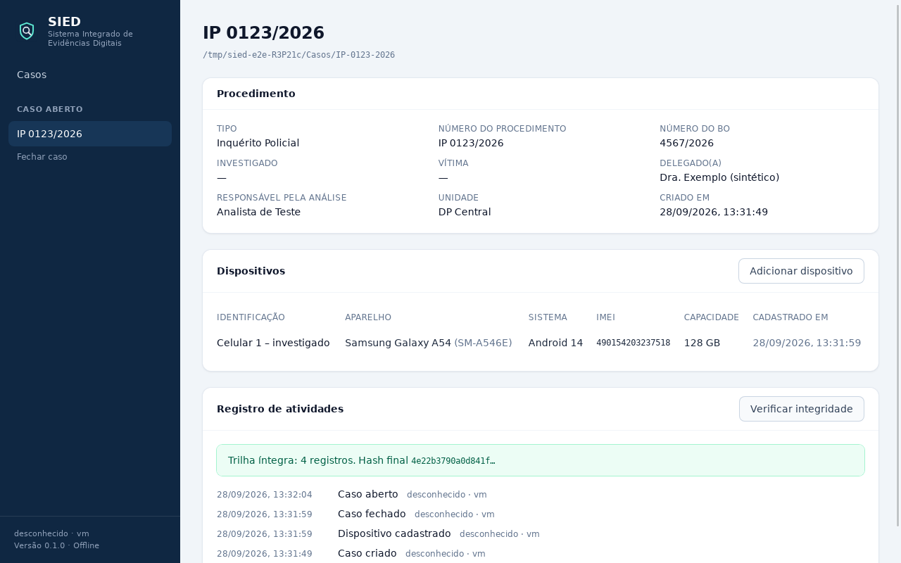

# Checkpoint — Fase 1, etapa 1: Fundação

Data: 28/09/2026 · Branch: `fase1-fundacao` (commit local, ainda não enviado ao GitHub)

Critério de aceite pedido: **iniciar o SIED → criar um caso → cadastrar um dispositivo → fechar o
programa → abrir novamente → verificar que os dados permaneceram.** Atendido e testado no app real
(ver "Testes realizados").

## Implementado

- **Workspace** Rust (3 crates de núcleo + app Tauri) e frontend React + TypeScript (Vite, Tailwind).
- **Tauri 2** com comandos tipados: informações do app, listar/criar/abrir/fechar caso, abrir pasta de
  caso, cadastrar/listar dispositivos, listar e verificar auditoria.
- **Banco global** (`sied-global.db`): catálogo de casos da estação e configurações.
- **Banco por caso** (`caso.sied.db`), autocontido: caso, dispositivos e trilha de auditoria.
  Copiar a pasta leva o caso inteiro; "Abrir pasta de caso…" registra a cópia em outra estação.
- **Migrações versionadas** para os dois bancos: SQL embutido, uma transação por migração, hash de
  cada migração conferido, `application_id` distinto para cada tipo de banco, recusa de banco mais
  novo que o SIED instalado e cópia de segurança antes de migrar um banco com dados.
- **Domínio Caso** (procedimento, nº do procedimento, nº do BO, investigado, vítima, delegado,
  responsável, unidade, observações, fuso) e **Dispositivo** (identificação, fabricante, modelo,
  nome comercial, sistema, versão, IMEI 1/2 com dígito verificador, serial, número, operadora,
  capacidade, observações), com validação no backend e erros por campo na interface.
- **Auditoria encadeada por hash**: caso criado/aberto/fechado e dispositivo cadastrado, gravados na
  mesma transação da ação; gatilhos impedem alteração e exclusão; botão "Verificar integridade".
- **Contrato de Artefato** (modelo universal): tipo, datas com valor original e formato, remetente,
  conteúdo, anexo, coordenadas, estado do registro, confiança, metadados e **referência de origem
  obrigatória** (tabela, ID do registro, consulta, valores brutos). Não há como criar um artefato sem ela.
- **Contratos de Importer e Parser** separados, fonte de extração **somente leitura** (sem métodos
  de escrita), parser recebe só cópia de trabalho verificada, e **protocolo JSON por linha** para
  parsers externos (Python, Java...) no futuro, sem nenhuma dependência nova.
- **AvillaImporter** registrado apenas como contrato: responde "não implementado" e não presume
  nenhuma estrutura de pastas.
- **Logs** técnicos diários (`<dados>\logs\sied.log.AAAA-MM-DD`), nível por `SIED_LOG`, registro de
  panics. **Erros** com código estável e mensagem em português até a interface.
- **Interface**: lista de casos, novo caso (com escolha da pasta), página do caso com procedimento,
  dispositivos (formulário de cadastro) e registro de atividades.
- **CI** (GitHub Actions) com testes no Linux e build do instalador no Windows — ainda não executado,
  roda quando a branch for enviada.

## Testes realizados

| Conjunto | Resultado |
|---|---|
| `cargo test --workspace` (domínio, bancos, migrações, auditoria, contratos, serviço do app) | 67 aprovados, 0 falhas |
| `cargo clippy --workspace --all-targets -D warnings` e `cargo fmt --check` | sem avisos |
| Interface: `tsc` (tipagem estrita) e `vitest` (formulário e formatação) | 7 aprovados |
| `npm run build` e `tauri build --debug` | compilam |
| **Ponta a ponta no app real** (`testes/e2e/executar.sh`) | aprovado |

O teste ponta a ponta abre o binário real do SIED numa tela virtual e, via WebDriver: cria o caso
"IP 0123/2026", tenta cadastrar um dispositivo com IMEI inválido (recusado com mensagem no campo),
corrige e salva, **fecha a janela como o usuário**, abre o programa de novo, encontra o caso na lista,
confere todos os campos, o dispositivo e as atividades (criado, cadastrado, fechado, aberto) e
verifica a integridade da trilha. A cadeia de hashes também foi recalculada de forma independente
(Python) sobre o arquivo do caso: íntegra.

Testes de armazenamento cobrem ainda: pasta de caso copiada continua válida; validação impede
gravação parcial; recusa de pasta não vazia e de caso duplicado; recusa de banco de outro tipo
(inclusive um SQLite qualquer, como um banco de evidência); recusa de banco de versão futura;
detecção de auditoria adulterada por fora do SIED; migrações idempotentes.

## Arquivos e áreas principais

- `Cargo.toml`, `.cargo/config.toml` — workspace
- `crates/sied-dominio/` — `caso.rs`, `dispositivo.rs`, `artefato.rs`, `ids.rs`, `validacao.rs`
- `crates/sied-armazenamento/` — `migracoes/{global,caso}/0001_inicial.sql`, `migracoes.rs`,
  `global.rs`, `caso.rs`, `auditoria.rs`, `tests/persistencia.rs`
- `crates/sied-ingestao/` — `fonte.rs`, `importador.rs`, `parser.rs`, `protocolo.rs`, `registro.rs`,
  `importadores/avilla.rs`, `tests/contratos.rs` (fixture sintética)
- `app/src-tauri/` — `lib.rs`, `comandos.rs`, `servico.rs`, `erro.rs`, `log.rs`, `tauri.conf.json`,
  `capabilities/default.json`
- `app/src/` — `api/` (cliente e consultas; `tipos/` gerado do Rust), `componentes/`, `rotas/`, `util/`
- `testes/e2e/` — teste ponta a ponta
- `.github/workflows/ci.yml`, `README.md`, `docs/ARQUITETURA.md` (ajustes aprovados registrados)
- `.gitignore` — bloqueia bancos, extrações, relatórios, `.env` e credenciais

## Decisões técnicas

1. **UUID v7** para caso e dispositivo: únicos entre estações, permitem anexar bancos de casos
   diferentes para correlação futura sem redesenho. Índices em IMEI e serial já preparam essa correlação.
2. **Tabelas só quando usadas**: o banco do caso tem hoje só caso, dispositivo e auditoria. Extrações,
   arquivos e artefatos entram como migração v2 junto com a importação, em vez de tabelas vazias.
3. **Migrações próprias** (≈100 linhas) em vez de biblioteca: permitem conferir o hash de cada migração
   aplicada, identificar o tipo de banco e fazer cópia de segurança antes de migrar.
4. **Auditoria na mesma transação** da ação: não existe ação gravada sem registro, nem registro sem ação.
   Um registro "caso aberto" sem "caso fechado" antes dele indica encerramento anormal.
5. **Regras do app fora do Tauri** (`servico.rs`), testáveis sem janela; comandos Tauri são uma camada fina.
6. **Tipos TypeScript gerados do Rust** (ts-rs) em vez de escritos à mão: frontend e backend não divergem.
   Preferido ao tauri-specta, que ainda está em versão candidata.
7. **Frontend sem acesso a disco**: permissões do Tauri limitadas ao núcleo e ao diálogo de pastas;
   CSP só permite o próprio app. Nada é carregado da internet (fontes do sistema).
8. **Instalador com WebView2 offline** para estações sem internet (Windows 10).
9. **`SIED_PASTA_DADOS` / `SIED_PASTA_CASOS`** permitem modo portátil e isolam os testes.
10. **Edição e exclusão** de caso e dispositivo ficaram de fora de propósito: exigem registrar o valor
    anterior na auditoria e serão feitas com esse cuidado.

## Problemas encontrados e como foram resolvidos

- **Versões do Tauri desalinhadas** (crate 2.12, pacotes JS 2.11): o CLI exige a mesma versão menor;
  alinhados em 2.12.
- **Testes de interface sem limpeza** entre casos: limpeza explícita após cada teste.
- **WebDriver do WebKit ignora texto com reticências (text-overflow)**: o teste lê `textContent`.
- **Fechar pelo WebDriver mata o processo** sem evento de fechamento, então "caso fechado" não era
  gravado. O app agora fecha o caso ao receber o pedido de fechamento da janela, e o teste fecha a
  janela por um gerenciador de janelas, como o usuário. Efeito colateral útil: ficou comprovado que
  dados confirmados sobrevivem a encerramento abrupto.
- **Banco global deixava o arquivo WAL ao sair** (o processo termina sem liberar a conexão):
  consolidação do WAL no encerramento.
- **Botão dentro de link** (HTML inválido) na lista de casos: substituído por navegação no botão.

## Como executar

Ver `README.md`. Em resumo, no Windows com Rust, Node 22 e C++ Build Tools:
`cd app && npm install && npm run tauri dev`. Instalador: `npm run tauri build`.

## Como testar

`cargo test --workspace` · `cd app && npm run typecheck && npm test` ·
ponta a ponta (Linux): `testes/e2e/executar.sh target/debug/sied-desktop`.

## Limitações atuais

- **Compilado e testado só em Linux** (ambiente de desenvolvimento em nuvem). O build para Windows está
  configurado e roda na CI assim que a branch for enviada ao GitHub; ainda não foi executado.
- O usuário registrado na auditoria é o usuário do Windows; não há login do SIED ainda.
- Sem edição/remoção de caso e dispositivo; um caso aberto por vez; sem trava contra abrir o mesmo
  caso em duas instâncias do SIED ao mesmo tempo.
- Nenhuma importação ainda; o AvillaImporter aguarda a árvore de uma extração real.
- Compilação mostra avisos informativos do ts-rs ("failed to parse serde attribute") sem efeito nos tipos.

## Próxima etapa proposta: primeiro sistema real de importação

1. Migração v2 do banco do caso: `extracao`, `arquivo`, `execucao_parser`, `artefato`, `referencia_origem`.
2. Fonte "pasta" somente leitura, inventário com SHA-256 de todos os arquivos, manifesto
   `sha256sum` da importação e hash do manifesto na auditoria.
3. Tarefas em segundo plano com progresso, cancelamento e retomada.
4. Cópia de trabalho verificada para bancos SQLite.
5. Importador "Pasta genérica" e tela "Importar extração" (vinculada a um dispositivo).
6. Adaptar o AvillaImporter quando a árvore da extração real chegar; depois, parser do WhatsApp.
