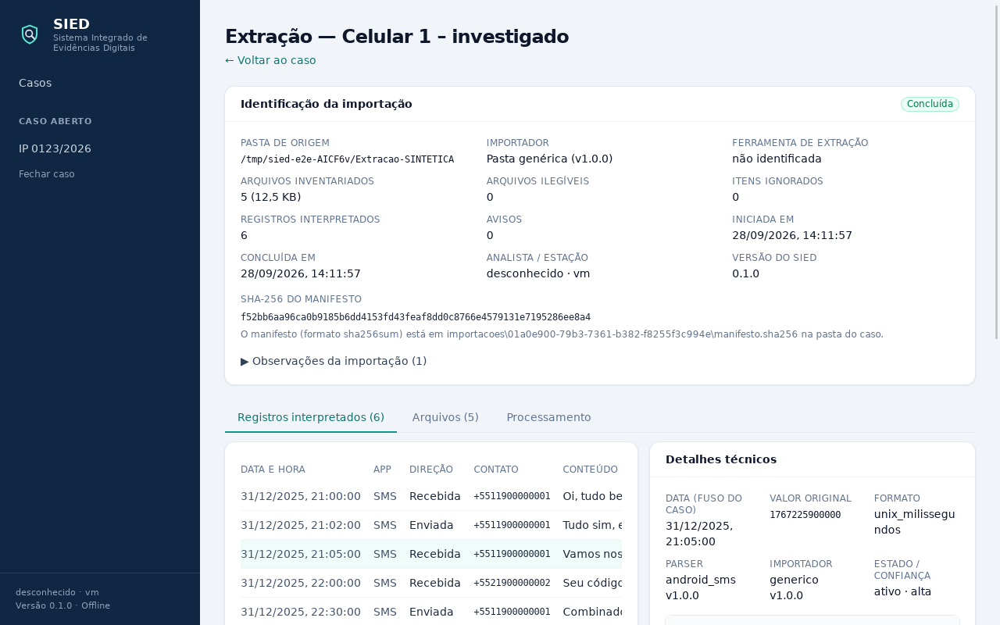

# Checkpoint — Fase 1, etapa 2: primeira importação real

Data: 28/09/2026 · Branch `fase1-importacao` · PR #2 (rascunho, sobre o PR #1)

Critério desta etapa: **importar uma pasta de extração sem alterá-la, com SHA-256 de todos os
arquivos, manifesto, cópia de trabalho verificada, pelo menos um parser real gravando registros com a
origem completa, progresso, cancelamento e auditoria.** Atendido e testado no app real.

## Implementado

- **Fonte "pasta" somente leitura**: só abre arquivos para leitura, não segue links simbólicos
  (poderiam apontar para fora da extração), percorre em ordem estável.
- **Inventário**: cada arquivo é lido uma única vez para calcular o SHA-256 e identificar o tipo pela
  assinatura do conteúdo (SQLite, JPEG, PNG, HEIC, MP4/3GP, OGG/Opus, MP3, AMR, PDF, ZIP, tar,
  backup Android, plist...). A extensão só é usada quando não há assinatura conhecida.
- **Manifesto** `importacoes\<id>\manifesto.sha256` no formato do `sha256sum`, verificável com
  ferramentas externas. O SHA-256 do manifesto vai para a extração e para a auditoria.
- **Log detalhado** `importacoes\<id>\log-importacao.jsonl`: plano, itens ignorados, erros de leitura,
  início e fim de cada parser.
- **Cópia de trabalho verificada**: antes de um parser ler um banco, o banco e o `-wal`/`-journal` são
  copiados para `cache\bancos\<id>\<arquivo>\` na pasta do caso, e o hash da cópia é comparado ao do
  inventário. Se o original mudou desde o inventário, a cópia é apagada e a leitura é recusada.
- **Migração v2 do banco do caso**: `extracao`, `arquivo`, `execucao_parser`, `aviso_parser`, `artefato`,
  `referencia_origem`. Gatilhos impedem alterar ou apagar inventário, artefatos e referências.
  Casos criados na etapa anterior são migrados ao abrir, com cópia de segurança.
- **Rastreabilidade completa por registro**: arquivo (caminho e SHA-256), tabela, ID do registro,
  consulta SQL usada, linha inteira em valores brutos, valor original da data e o formato, parser e
  versão, importador e versão, extração e hash do manifesto. Cada registro também guarda o SHA-256 da
  sua forma normalizada.
- **Importador "Pasta genérica"**: aceita qualquer pasta. Interpreta bancos com nome padrão do Android
  (`mmssms.db`) em qualquer ponto da árvore.
- **Parser SMS Android** (`android_sms` 1.0.0): tabela `sms` do AOSP, leitura somente leitura da cópia,
  incluindo registros que só existem no `-wal`. Colunas obrigatórias conferidas, e registros ilegíveis
  viram avisos sem interromper.
- **Importação em segundo plano**: thread e conexão próprias, progresso (etapa, arquivos, bytes, item
  atual, registros) e cancelamento. Fechar o caso ou o programa durante a importação a cancela e
  registra. Importação interrompida por queda de energia é marcada como "interrompida" ao reabrir.
- **Auditoria**: importação iniciada, concluída, cancelada, falhou ou interrompida, com totais e hash do
  manifesto. As duas conexões usam transação `IMMEDIATE`, para a cadeia nunca bifurcar.
- **Telas**:
  - Assistente de importação: dispositivo, pasta (escolher ou colar o caminho), detecção com os
    motivos de cada importador. O Avilla aparece como "ainda não disponível".
  - Progresso ao vivo.
  - Página da extração com identificação e hash do manifesto e três abas: registros com painel de
    detalhes técnicos, inventário filtrável por tipo e buscável por caminho ou SHA-256, e processamento.
- **Gerador de extração sintética** `testes/gerador/extracao_sintetica.py`, para testes e para
  experimentar.

## Testes realizados

| Conjunto | Resultado |
|---|---|
| `cargo test --workspace` | 99 aprovados, 0 falhas (eram 67) |
| `cargo clippy -D warnings`, `cargo fmt --check` | sem avisos |
| `tsc` e `vitest` | 9 aprovados (eram 7) |
| **Ponta a ponta no app real**, com importação | aprovado |

O que os novos testes provam:

- A pasta da extração não muda: o hash e a data de modificação de cada arquivo são iguais antes e
  depois da importação e depois de reabrir o SIED.
- Cada linha do manifesto confere com o arquivo real, e o hash do manifesto mostrado na tela é o do
  arquivo gravado.
- O SMS gravado só no `-wal` é recuperado.
- A referência de origem aponta o arquivo, o hash, a tabela, `_id` e a linha bruta corretos.
- Um original alterado entre o inventário e a cópia é recusado, e a cópia divergente é apagada.
- Cancelamento, fechamento no meio e interrupção ficam registrados, e a auditoria verifica íntegra em
  todos os casos.
- Um caso da etapa anterior (só v1) é migrado com cópia de segurança.
- Inventário e artefatos não aceitam `UPDATE` nem `DELETE`.
- Uma pasta de extração dentro da pasta do caso, ou que a contenha, é recusada.

## Arquivos e áreas principais

- `crates/sied-ingestao/src/`:
  - `fonte/pasta.rs`, `inventario.rs`, `pipeline.rs`
  - `importadores/generico.rs`, `parsers/android_sms.rs`, `parsers/sqlite.rs`
  - testes em `tests/pipeline.rs`
- `crates/sied-armazenamento/`:
  - `migracoes/caso/0002_importacao.sql`
  - `src/importacao.rs` (gravação), `src/extracoes.rs` (consultas), `src/caso.rs`
  - testes em `tests/importacao.rs`
- `app/src-tauri/src/`: `servico.rs` (importação em segundo plano), `comandos.rs`, `erro.rs`
- `app/src/`: `componentes/Importacao.tsx`, `rotas/PaginaExtracao.tsx`, `rotas/PaginaCaso.tsx`,
  `util/rotulos.ts`
- `testes/gerador/extracao_sintetica.py`, `testes/e2e/persistencia.mjs`, `README.md`

## Decisões técnicas

1. **Inventário completo antes de interpretar.** O manifesto cobre a extração inteira, não só o que
   algum parser leu, e um arquivo ilegível aparece no inventário com o erro, sem hash.
2. **Hash e classificação na mesma leitura**: a extração é lida uma vez no inventário e uma vez por
   banco copiado, nunca mais que isso.
3. **Cópia de trabalho por arquivo** (`cache\bancos\<extração>\<arquivo>\`), e não por hash como previa
   a arquitetura: dois bancos iguais com `-wal` diferentes não podem compartilhar a cópia.
4. **`-shm` não é copiado**: é índice temporário do SQLite, reconstruído a partir do `-wal`, e poderia
   estar inconsistente. O parser lê a cópia em modo somente leitura.
5. **Importação com conexão própria + `BEGIN IMMEDIATE` em toda escrita da auditoria**: a interface
   continua usável durante a importação e a cadeia de hashes nunca bifurca.
6. **Tabelas de conversas, pessoas e busca (FTS) ainda não criadas**: entram com o parser do WhatsApp e
   a busca, quando forem usadas. O SMS já guarda `conversa_id_externo` (thread_id).
7. **Importador genérico reconhece o banco pelo nome padrão do Android**, não pela estrutura de
   nenhuma ferramenta. O Avilla continua sem presumir estrutura.
8. **Datas do SMS**: `date` em milissegundos UTC, exibida no fuso do caso (Brasília), e o valor
   original fica preservado. Nas telas, 01/01/2026 00:00 UTC aparece como 31/12/2025 21:00.

## Problemas encontrados e como foram resolvidos

- **O clippy mais novo da CI** apontou `is_multiple_of` no código da fundação (o PR #1 ficou vermelho
  no Linux). Corrigido no PR #1. O build e os testes no **Windows passaram** nessa execução.
- **Teste ponta a ponta com condição de corrida**: as seções da página carregam separadamente, então o
  teste passou a esperar cada uma.
- **O WebDriver do WebKit não clica em células com reticências**: o teste clica na célula da data, e as
  linhas passaram a ser selecionáveis também pelo teclado.
- **O diálogo nativo de pastas não é controlável por automação**: o assistente ganhou um campo para
  colar o caminho, útil também para o analista, que costuma copiar o caminho do Explorer.

## Como executar

Como antes (`cd app && npm install && npm run tauri dev`). Para experimentar a importação sem dados
reais: `python testes\gerador\extracao_sintetica.py C:\Temp\Extracao-SINTETICA` e, no caso, use
"Importar extração" com essa pasta.

## Como testar

- `cargo test --workspace`
- `cd app && npm run typecheck && npm test`
- Ponta a ponta (Linux): `testes/e2e/executar.sh target/debug/sied-desktop`
- Conferir o manifesto por fora: na raiz da extração, `sha256sum -c <caso>/importacoes/<id>/manifesto.sha256`.

## Limitações atuais

- **Avilla** continua sem importador: falta a árvore de uma extração real e as opções usadas.
- **Contêineres** (`.tar`, `.zip`, `.ab`) são inventariados e têm hash, mas não são abertos.
- Só **SMS** é interpretado (sem MMS). WhatsApp, contatos e chamadas são as próximas etapas.
- O hash é calculado em uma única thread (limitado pelo disco na prática). Não há retomada de
  importação interrompida: importa-se de novo, e a interrompida fica registrada.
- Sem busca global, conversas reconstruídas, evidências e relatório PDF (próximas etapas da fase 1).
- Não há exclusão de extração (inventário e artefatos são somente inclusão, de propósito).
- Não há verificação do "hash declarado" do laudo de aquisição.

## Próxima etapa proposta

1. **Importador do Avilla**, assim que a árvore (`tree /F /A > arvore.txt`) e as opções usadas chegarem.
2. **WhatsApp Android** (`msgstore.db` + `wa.db`, esquemas antigo e novo), com as tabelas `conversa`
   e `pessoa`.
3. **Conversas reconstruídas** no estilo do app, com alternância para a visão técnica que já existe.
4. **Busca global (FTS5)** sobre registros e nomes de arquivo.
