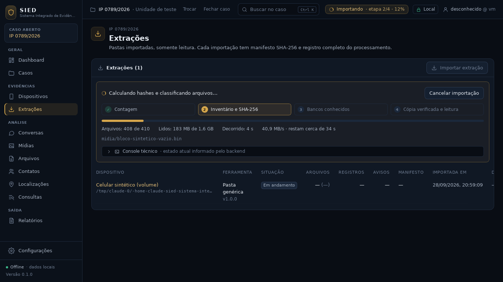
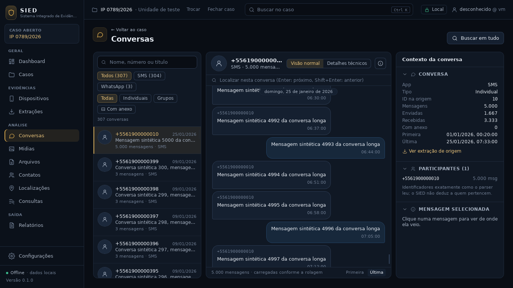
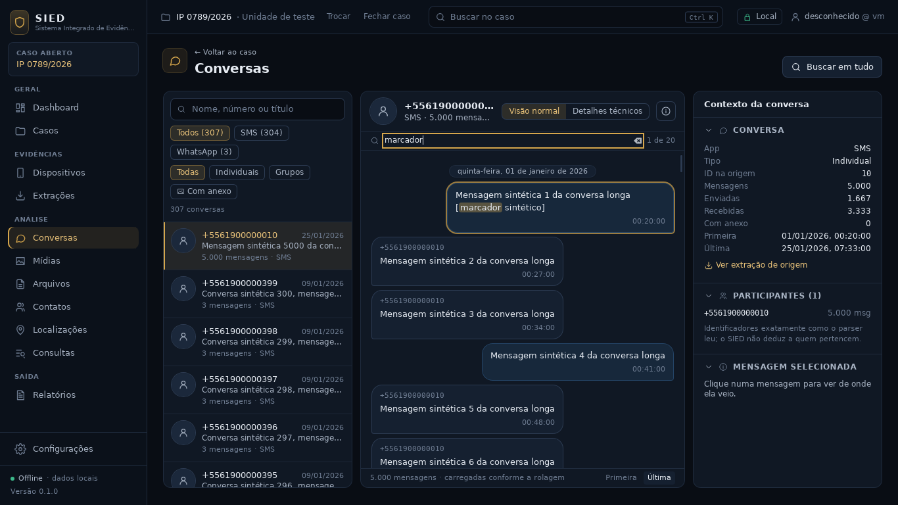
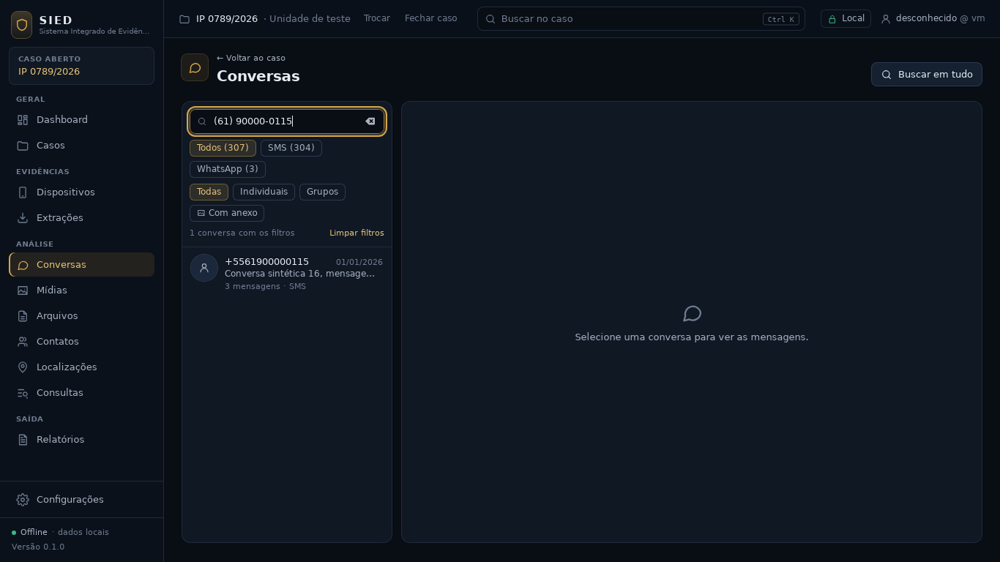
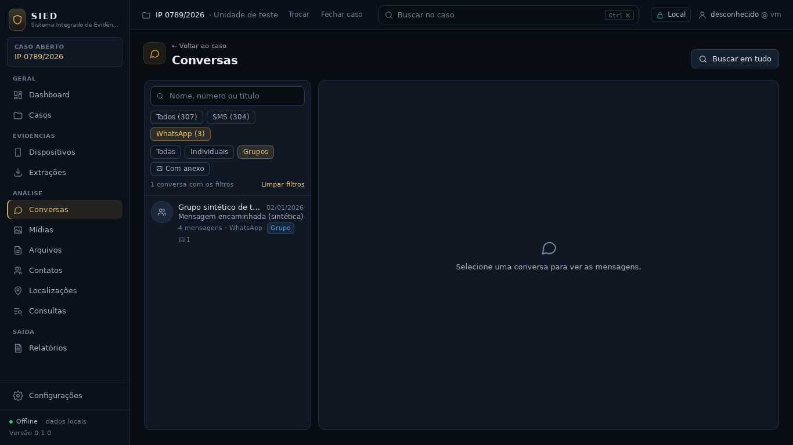
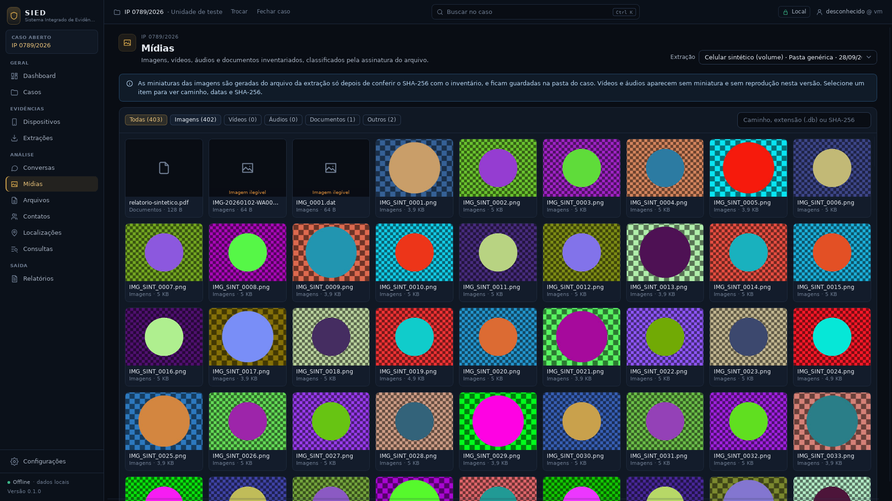
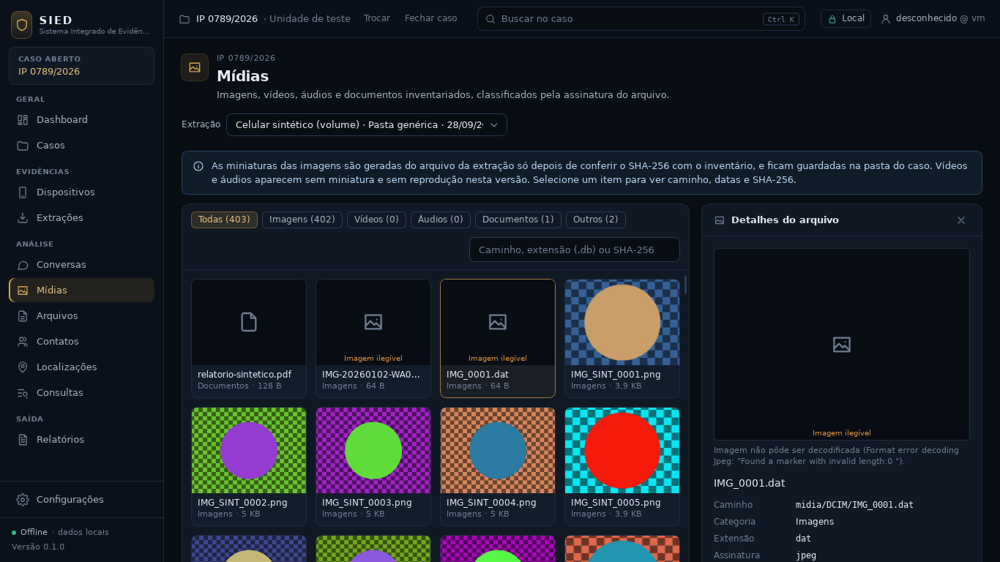
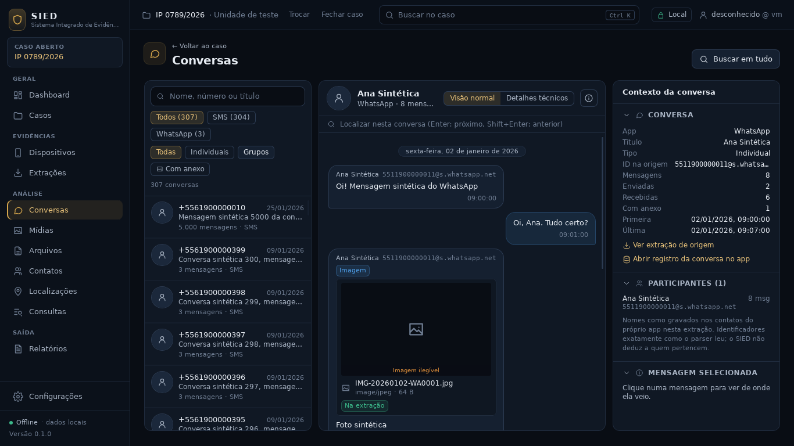

# Checkpoint — Interface para volume real

Data: 28/09/2026 · Branch `fase1-visual-volume` (criada da `main` em `dc402cf`) · PR #9, **em
rascunho, sem merge** (o merge depende do aval do usuário).

Critério desta etapa (pedido do usuário, "os 2 nesta ordem", parte 1): **deixar a interface pronta
para uma extração real grande: miniaturas das mídias na galeria e nas conversas, listas
virtualizadas, filtros de conversa sobre o caso inteiro e um indicador simples de progresso da
importação com eventos reais do backend.** O console completo do §14 continua fora do escopo.
Atendido e conferido no app real com uma extração sintética de 410 arquivos (1,6 GB), 5.906 SMS
em 304 conversas e 400 imagens.



## IMPLEMENTADO

**Miniaturas** (crate novo `sied-midia`)
- O arquivo é lido da pasta da extração pela mesma fonte somente leitura da importação.
- O SHA-256 é conferido com o inventário **antes** de decodificar; se difere, a miniatura é
  recusada, a tela diz "Arquivo difere do inventário" e o log técnico registra o aviso.
- JPEG, PNG, GIF, WebP, BMP e TIFF; orientação EXIF aplicada; lado maior 320 px, sem ampliar
  imagens pequenas; limite de 256 MB por arquivo e de dimensões/memória no decodificador.
- Cache em `<pasta do caso>/miniaturas/<sha[..2]>/<sha>-v1.jpg`, gravado de forma atômica
  (temporário + renomear). Com a miniatura no cache, a evidência nem é lida de novo.
- No máximo 4 gerações simultâneas; o comando roda fora da trava do caso para não travar a tela.
- Sem miniatura, a tela mostra o ícone do tipo e o motivo: origem indisponível, arquivo difere do
  inventário, imagem ilegível (com o detalhe do decodificador) ou formato sem suporte (HEIC,
  vídeo, áudio).
- Onde aparecem: grade de Mídias, painel de detalhes do arquivo e anexos das conversas ligados ao
  inventário.

**Listas virtualizadas**
- Conversas (acima de 100), mensagens (acima de 500) e grade de mídias (acima de 100): só as linhas
  perto da área visível existem na tela, e as páginas vêm do banco conforme a rolagem.
- Abaixo desses limites, o caminho antigo continua igual (os testes existentes seguem passando sem
  alteração).
- Conversa longa: cabeçalho flutuante com o dia, botões "Primeira" e "Última".

**Filtros de conversa no banco** (valem para o caso inteiro, não só para a página carregada)
- Texto: título do grupo, id da conversa, participante, nome no app e telefone com ou sem máscara.
- App (com a contagem de conversas de cada um), individuais ou grupos, "com anexo", extração.
- Linha de estado "N conversas com os filtros" e "Limpar filtros".

**Localizar e posição**
- Em conversa longa, Localizar pergunta ao banco: total de ocorrências e a posição de cada uma na
  ordem da conversa. Enter e Shift+Enter navegam; a lista rola até a ocorrência e busca a página
  dela.
- Vindo da busca global, a conversa rola até o registro mesmo que ele esteja além da primeira
  página (antes, só era destacado se estivesse nas 500 primeiras).

**Progresso da importação**
- O backend passou a informar: início da importação e da etapa, fase da tarefa ("copiando e
  conferindo" ou "interpretando") e bytes da cópia de trabalho já conferidos.
- A tela mostra as quatro etapas (contagem, inventário e SHA-256, bancos conhecidos, cópia
  verificada e leitura), a barra da etapa atual, arquivos, bytes, bancos, registros, avisos, tempo
  decorrido e, no inventário, a taxa e o tempo restante medidos desde o início da etapa.
- Etapas sem medida (contagem, identificação dos bancos) deixam a barra indeterminada, em vez de
  inventar um percentual.
- Cabeçalho: "Importando · etapa n/4 · %".
- O console técnico (recolhido) ganhou as linhas da tarefa e da cópia.

**Gerador sintético**
- `--volume`: conversa SMS com 5.000 mensagens (com um "marcador sintético" a cada 250), 300
  conversas curtas e 400 imagens PNG desenhadas pelo próprio gerador (faixas e um círculo; sem
  pessoas nem texto). Sem a opção, a saída é a de sempre (o E2E usa essa).

## TESTES

| Conjunto | Antes (`main`) | Agora | Resultado |
|---|---|---|---|
| Rust (`cargo test --workspace`) | 140 | 155 | todos passam |
| Interface (`vitest`) | 26 | 35 | todos passam |
| `cargo fmt --check`, `cargo clippy -D warnings`, `tsc` | — | — | limpos |
| Build da interface e do app (`tauri build --debug --no-bundle`) | — | — | ok |
| Ponta a ponta no app real (`testes/e2e`) | 1 roteiro | igual | passa; extração intacta |

Novos:
- `crates/sied-midia/src/testes.rs` (6): reduz e guarda no cache, e o cache vale mesmo sem a
  evidência; a extração não muda (conteúdo e datas); PNG pequeno não é ampliado; hash divergente é
  recusado sem gravar cache; origem ausente e tipos sem suporte; imagem corrompida e HEIC; 8
  pedidos simultâneos sem temporários esquecidos.
- `crates/sied-armazenamento/tests/volume.rs` (3): filtros sobre 1.200 mensagens e 4 conversas
  (texto, telefone mascarado, app, tipo, anexo, extração); posição e localizar na ordem da conversa,
  inclusive mensagens sem data; arquivo com a pasta de origem e progresso final.
- `app/src/rotas/VolumeReal.test.tsx` (9): lista longa desenha só o visível e busca a última
  página ao rolar; filtros chegam ao banco e "Limpar filtros"; conversa longa virtualizada com
  localizar no banco e rolagem até a mensagem 900; miniatura no anexo; grade longa com miniaturas e
  o aviso de arquivo divergente; etapas, barra, cópia verificada, tempo decorrido, taxa e tempo
  restante; barra indeterminada sem medida; resumo no cabeçalho.

Nenhum teste existente foi removido ou alterado. O roteiro do E2E é o mesmo.

## Telas do app real (extração sintética com volume)















As 26 capturas (1366×768 e 1920×1080, com a sequência do progresso) estão em
`/mnt/project-files/sied/capturas/visual-volume/`.

## ARQUIVOS

- `crates/sied-midia/` (novo): `Cargo.toml`, `src/lib.rs`, `src/testes.rs`.
- `crates/sied-armazenamento/src/conversas.rs`: `FiltroConversas`, `apps`, `posicao_mensagem`,
  `localizar`; `extracoes.rs`: `arquivo_com_origem`; `caso.rs`: métodos correspondentes;
  `tests/volume.rs` (novo).
- `crates/sied-ingestao/src/pipeline.rs`: campos novos do `Progresso` e `FaseTarefa`.
- `app/src-tauri/src/{comandos,servico,lib}.rs`: `listar_conversas` com filtros opcionais,
  `apps_das_conversas`, `posicao_mensagem`, `localizar_na_conversa`, `miniatura` (assíncrono).
- `app/src/api/{cliente,consultas}.ts`, `app/src/api/tipos/` (gerados).
- `app/src/util/listaPaginada.ts`, `app/src/util/progresso.ts`, `app/src/componentes/Miniatura.tsx`
  (novos).
- `app/src/componentes/{Arquivos,Importacao,BarraSuperior}.tsx`,
  `app/src/rotas/{PaginaConversas,PaginasModulos}.tsx`.
- `app/src/rotas/VolumeReal.test.tsx` (novo); `app/package.json` (`@tanstack/react-virtual`).
- `testes/gerador/extracao_sintetica.py` (`--volume`).
- `README.md`, `docs/CONTINUIDADE.md`, este checkpoint e `docs/checkpoints/visual-volume/`.

## DECISÕES

1. Miniatura é dado derivado, fora do banco do caso, reconstruível e apagável. Nome pelo SHA-256:
   a mesma imagem em duas extrações usa uma miniatura só.
2. Conferir o hash antes de decodificar: a tela nunca mostra uma imagem que não seja a do
   inventário.
3. A imagem chega à tela como `data:` pelo comando do app; a política de conteúdo continua só com
   imagens locais (`img-src 'self' data:`), sem abrir acesso a arquivos.
4. Virtualização só acima do tamanho de página; abaixo, o DOM é o mesmo de antes.
5. Filtros e localizar como SQL sobre o caso inteiro; a tela não filtra dados carregados.
6. O comando `listar_conversas` ganhou argumentos opcionais em vez de um comando novo, para manter
   o contrato usado pelos testes existentes.
7. Progresso: só números do backend. Estimativa de tempo só onde há medida contínua (bytes do
   inventário) e só depois de 3 segundos de medida.
8. Não foi criada migração: nada muda no esquema do banco do caso.

## PROBLEMAS

- `thumbnail()` da biblioteca ampliava imagens pequenas; agora a redução só acontece acima de
  320 px (teste `png_pequeno_nao_e_ampliado`).
- Imagens em retrato apareciam deslocadas na grade no WebKit; a miniatura passou a ocupar a caixa
  com posicionamento absoluto.
- O cabeçalho flutuante do dia duplicava o separador no topo da conversa; agora aparece só depois
  de rolar.
- O texto de erro do decodificador trazia `\n`; foi normalizado para uma linha.
- O jsdom não calcula layout: os testes novos definem altura, largura e rolagem da área só dentro
  do próprio arquivo de teste e restauram tudo ao final.

## COMO EXECUTAR

```
cd app && npm install && npm run tauri dev
python3 testes/gerador/extracao_sintetica.py --whatsapp --volume C:\Temp\Extracao-VOLUME
```

Importe a pasta gerada e abra Conversas e Mídias.

## COMO TESTAR

```
cargo fmt --all -- --check
cargo clippy --workspace --all-targets -- -D warnings
cargo test --workspace
cd app && npx tsc -p . && npm test && npm run build
cd app && npx tauri build --debug --no-bundle && cd .. && testes/e2e/executar.sh target/debug/sied-desktop
```

## LIMITAÇÕES

- HEIC/HEIF, vídeos e áudios sem miniatura e sem reprodução.
- Localizar em conversa longa compara minúsculas só em letras sem acento; traz as 1.000 primeiras
  ocorrências.
- Arquivos (tabela) e Contatos seguem paginados de 100 em 100.
- Na leitura dos bancos, a barra avança por banco concluído; o tempo de cada parser não é estimado.
- O anexo de foto do WhatsApp na extração sintética é um arquivo de 64 bytes que não é imagem, por
  isso aparece "Imagem ilegível" (o teste de importação depende desse tamanho).
- Conferido só com dados sintéticos.

## PRÓXIMA FASE

Parte 2 do pedido: **seleção de evidências e relatório PDF em Typst**, com hashes, origem e
cadeia de custódia, em branch própria.
