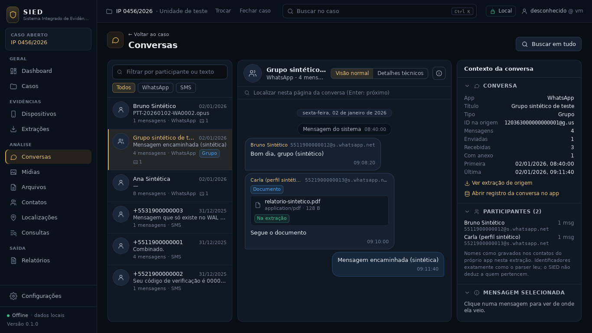
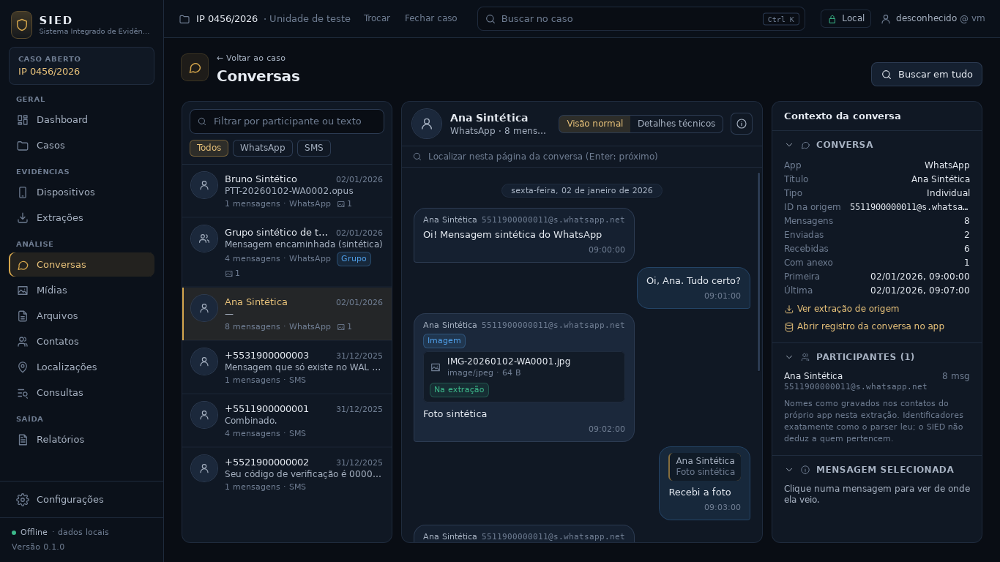
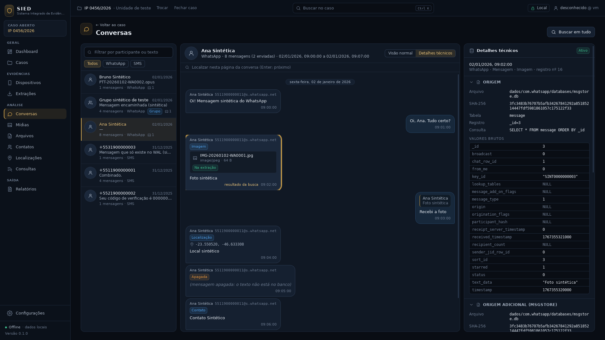
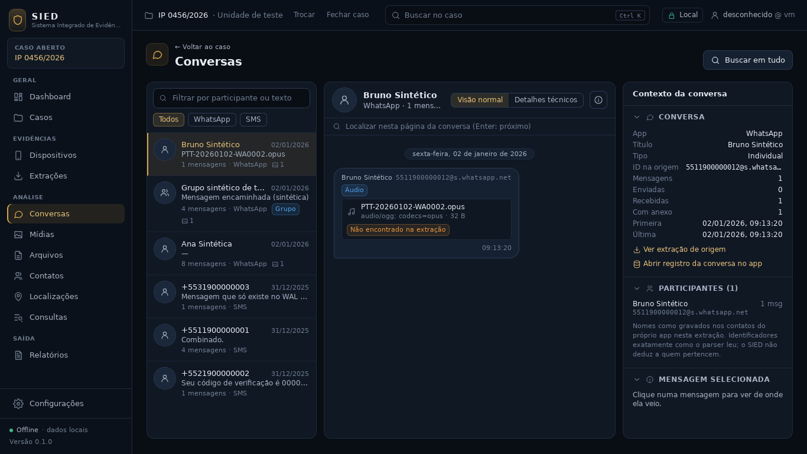
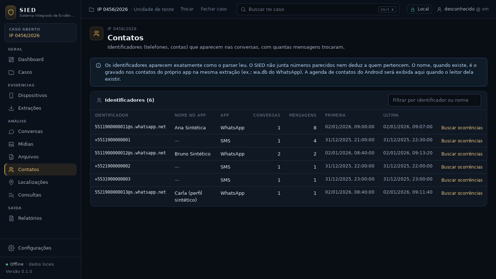
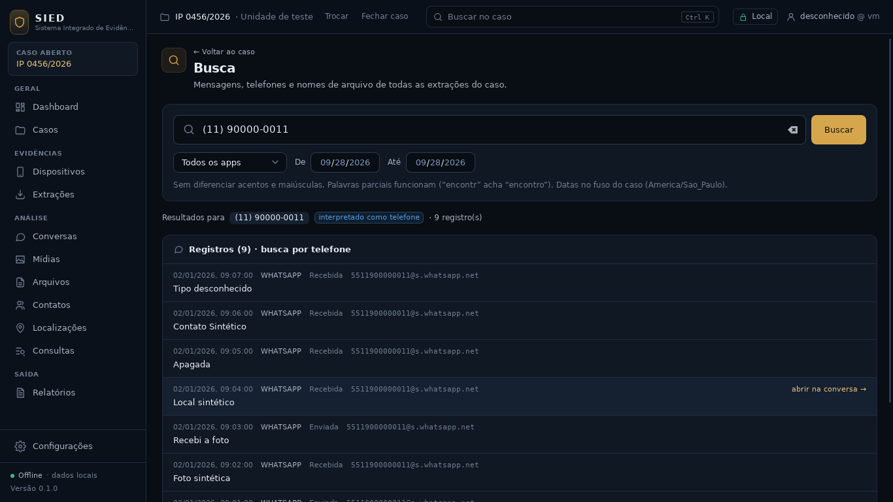
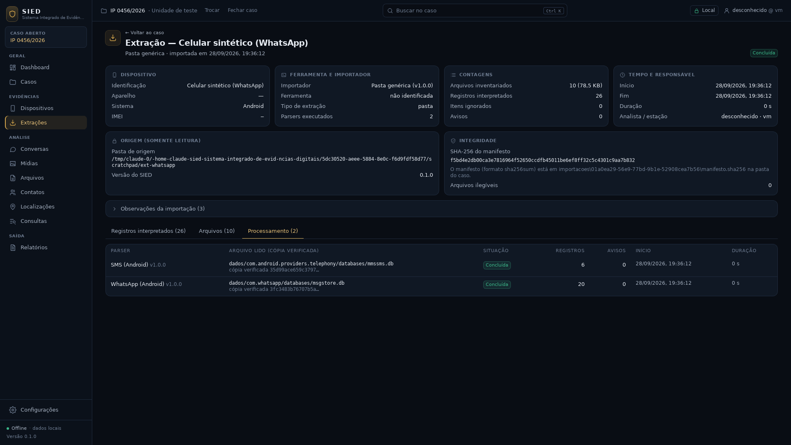

# Checkpoint — Leitor WhatsApp Android

Data: 28/09/2026 · Branch `fase1-whatsapp` (criada da `main` em `85273d1`) · PR #8, **em rascunho,
sem merge** (o merge desta fase depende do aval do usuário).

Critério desta fase (plano do `docs/CONTINUIDADE.md` §13): **ler o `msgstore.db` nos dois esquemas
e o `wa.db` do WhatsApp Android, com o esquema detectado pelo conteúdo, valores brutos
preservados, grupos, contatos e anexos ligados ao inventário, e mostrar as conversas com título,
tipo e nomes, sem nenhum dado real e sem presumir a estrutura do Avilla.** Atendido e testado no
app real com uma extração sintética.



## IMPLEMENTADO

**Parser `whatsapp_android` v1.0.0** (`crates/sied-ingestao/src/parsers/whatsapp_android/`)
- Detecção do esquema pelo conteúdo, nunca pela versão do app:
  - esquema novo `message` (`message`, `chat`, `jid` e tabelas auxiliares);
  - esquema antigo `messages` (`messages`, `chat_list`, `group_participants`, `messages_quotes`).
  - Se as duas existem, vale `message`, a não ser que esteja vazia e `messages` tenha linhas.
  - Nenhum dos dois leva a um erro que lista o que falta.
- Mensagens: texto, imagem, áudio, vídeo, documento, GIF, figurinha, contato (vCard), localização
  (inclusive em tempo real), sistema, resposta (citação), encaminhada e apagada.
- Código desconhecido vira subtipo `desconhecido`, com confiança média e o código bruto nos
  metadados.
- Situação de envio (`recebida`, `enviada_ao_servidor`, `entregue`, `lida`, `reproduzida`), sempre
  com o `status` bruto ao lado.
- Grupos: remetente de cada mensagem recebida. Um registro `conversa` por chat, com assunto, tipo
  (individual, grupo, status, lista de transmissão, canal) e membros.
- Contatos do `wa.db` (`wa_contacts`): nome da agenda ou nome de perfil, com a fonte do nome
  indicada.
- Origem: cada registro aponta para a linha principal. As linhas auxiliares entram como origens
  adicionais com os valores brutos: mídia, citação, localização, vCard, encaminhamento, sistema,
  `jid` e membros.
- `wa.db` ilegível ou de formato desconhecido vira aviso quando há `msgstore.db`: as conversas
  continuam, só que sem nomes.
- `-wal` lido, como no SMS.
- WhatsApp Business (`com.whatsapp.w4b` no caminho) recebe o app `whatsapp_business`.

**Importador genérico**
- `msgstore.db` e `wa.db` da mesma pasta formam uma tarefa só.
- `wa.db` sozinho vira uma tarefa só de contatos.
- Backups cifrados (`msgstore*.crypt*`) são inventariados com hash e registrados como observação,
  sem tentativa de decifrar.

**Anexos ligados ao inventário** (pipeline)
1. Primeiro o caminho exato.
2. Depois o arquivo com o maior trecho final de caminho em comum, desde que seja único e que o
   tamanho confira quando o app informa o tamanho.
3. Só o nome em comum exige tamanho igual.
4. Empate ou tamanho diferente nunca liga.

O resultado vai em `artefato.anexo_vinculo`: `caminho_exato`, `sufixo_caminho`, `nome_e_tamanho`,
`ambiguo`, `tamanho_diferente` ou `nao_encontrado`.

**Banco do caso (migração 4)**
- Coluna `anexo_vinculo`.
- Índices por nome de arquivo e por identificador externo.
- Cópia de segurança `.antes-v4.bak`, como nas migrações anteriores.

**Consultas**
- Conversas ganham `titulo`, `tipo` e `registro_id`.
  - O título é o assunto do registro `conversa` ou, sem ele, o nome do contato.
  - Os participantes ganham `nome`.
  - Tudo é resolvido na consulta a partir dos registros da mesma extração; nada é gravado na
    conversa derivada.
- Identificadores (tela Contatos) ganham `nome` e filtro por nome.
- A busca por telefone também acha o registro de contato pelo identificador.
- A prévia da conversa usa o nome do anexo quando a mensagem não tem texto.

**Interface**
- Conversas mostram:
  - título e tipo;
  - remetente com nome e identificador;
  - mensagem de sistema centralizada;
  - bloco de anexo com nome, tipo e tamanho, e a situação: "Na extração", "Mais de um arquivo
    possível", "Não encontrado na extração" ou "Tamanho não confere";
  - coordenadas, trecho da mensagem respondida e "Apagada".
- Contexto da conversa: título, tipo, nomes dos participantes e "Abrir registro da conversa no
  app".
- Visão técnica: novas seções Anexo (caminho no app, vínculo, arquivo, SHA-256 e tamanho) e
  Localização.
- Registros da extração e da busca mostram o tipo quando não é mensagem.
- Contatos: coluna "Nome no app".

**Gerador sintético**: `--whatsapp` acrescenta bancos, mídias e um `.crypt14` inventados. Sem a
opção, a saída é a mesma de antes.

## TESTES

| Conjunto | Resultado |
|---|---|
| `cargo test --workspace` | **140** aprovados, 0 falhas (eram 114) |
| `cargo clippy -D warnings`, `cargo fmt --check` | limpos |
| Typecheck TypeScript e `vitest` | **26** aprovados, 0 falhas (eram 23) |
| `npm run build` e `tauri build --debug --no-bundle` | ok |
| Ponta a ponta no app real (`testes/e2e`) | aprovado, **mesmo roteiro, nenhuma verificação alterada**; pasta da extração intacta |
| App real com a extração sintética `--whatsapp` | importação concluída: 10 arquivos, 26 registros (6 SMS e 20 WhatsApp), 0 avisos; hash de todos os arquivos da pasta igual antes e depois |
| CI do PR #8 | ver a mensagem de fechamento da fase na thread (Linux e Windows) |

**Testes novos**

Parser (`whatsapp_android/testes.rs`, 10, e `comum.rs`, 5):
- esquema novo completo e esquema antigo completo;
- mensagem que só existe no `-wal`;
- cópias de trabalho intactas;
- esquema desconhecido recusado;
- preferência entre os esquemas;
- só `wa.db`;
- `wa.db` ilegível vira aviso;
- mensagem de grupo sem remetente vira aviso;
- nenhum arquivo é erro.

Pipeline e importador:
- `escolher_anexo`: sufixo, ambíguo, tamanho diferente, só nome e sem candidatos (5);
- plano junta `msgstore.db` e `wa.db` (1).

Banco do caso (`tests/whatsapp.rs`, 3):
- importação completa com títulos, nomes, anexos (sufixo, ambíguo, não encontrado), localização,
  resposta, busca por telefone, identificadores com nome e pasta intacta;
- esquema antigo com caminho exato;
- caso na versão 3 migrado para a 4 com cópia de segurança e sem perda.

Interface (`ConversasWhatsApp.test.tsx`, 3): título com e sem nome, e chat com sistema, nomes,
anexos, localização, resposta e apagada. Contexto com nomes e registro da conversa.

**Ajustes em testes existentes** (sem mudar o que conferem)
- `tests/importacao.rs`: os dois testes que simulam casos antigos (v1 e v2) passaram a desfazer
  também a migração 4. O mesmo foi feito quando a migração 3 entrou. As verificações são as
  mesmas.
- `Conversas.test.tsx`: os dados sintéticos do SMS receberam os campos novos com `null`, exigidos
  pelo TypeScript. As verificações são as mesmas.

## Amostras reconstruídas (extração sintética, app real)

| Registro | Tipo | Remetente | Conteúdo | Anexo ou extra | Origem |
|---|---|---|---|---|---|
| SINT…001 | texto, recebida | Ana Sintética (`…0011@s.whatsapp.net`) | Oi! Mensagem sintética do WhatsApp | — | `message:_id=1` |
| SINT…002 | texto, enviada, `lida` | — | Oi, Ana. Tudo certo? | — | `message:_id=2` |
| SINT…003 | imagem | Ana | Foto sintética | `…/WhatsApp Images/IMG-20260102-WA0001.jpg`, `sufixo_caminho` | `message:_id=3` + `message_media` |
| SINT…004 | texto, enviada, `entregue` | — | Recebi a foto | resposta a SINT…003 | `message:_id=4` + `message_quoted` |
| SINT…005 | localização | Ana | Local sintético | −23,550520; −46,633308 | `message:_id=5` + `message_location` |
| SINT…006 | apagada | Ana | (sem texto) | — | `message:_id=6` |
| SINT…008 | desconhecido (código 99) | Ana | (sem texto) | confiança média | `message:_id=8` |
| SINT…009 | sistema (grupo) | — | — | `action_type` 11 | `message:_id=9` + `message_system` |
| SINT…011 | documento (grupo) | Carla (perfil sintético) | Segue o documento | `relatorio-sintetico.pdf`, `sufixo_caminho` | `message:_id=11` + `message_media` |
| SINT…012 | texto, enviada (grupo) | — | Mensagem encaminhada (sintética) | encaminhada | `message:_id=12` + `message_forwarded` |
| SINT…013 | áudio | Bruno Sintético | — | `PTT-20260102-WA0002.opus`, `nao_encontrado` | `message:_id=13` + `message_media` |
| grupo | conversa (grupo) | — | Grupo sintético de teste | 2 membros | `chat:_id=2` + `jid` + `group_participant_user` |
| Carla | contato | — | Carla (perfil sintético) | nome de perfil (sem nome na agenda) | `wa_contacts:_id=3` |













## ARQUIVOS

| Caminho | O quê |
|---|---|
| `crates/sied-ingestao/src/parsers/whatsapp_android/` | `mod.rs` (detecção e fluxo), `novo.rs`, `antigo.rs`, `contatos.rs`, `comum.rs`, `testes.rs` |
| `crates/sied-ingestao/src/importadores/generico.rs` | tarefa `msgstore.db` + `wa.db`; observação de `.crypt` |
| `crates/sied-ingestao/src/pipeline.rs` | `VinculoAnexo`, `escolher_anexo`, `Destino::arquivos_com_nome` |
| `crates/sied-ingestao/src/registro.rs`, `parsers/mod.rs` | registro do parser |
| `crates/sied-dominio/src/artefato.rs` | tipo `conversa` |
| `crates/sied-armazenamento/migracoes/caso/0004_whatsapp.sql`, `src/migracoes.rs` | migração 4 |
| `crates/sied-armazenamento/src/{importacao,extracoes,conversas,resumo,busca}.rs` | vínculo gravado, colunas do resumo, anexo no detalhe, título, tipo e nomes, busca de contatos |
| `crates/sied-armazenamento/tests/whatsapp.rs` | testes de ponta a ponta no banco do caso |
| `testes/fixtures/whatsapp/*.sql`, `LEIAME.md` | fixtures SINTÉTICAS |
| `testes/gerador/extracao_sintetica.py` | opção `--whatsapp` |
| `app/src/rotas/PaginaConversas.tsx`, `componentes/PainelTecnico.tsx`, `rotas/PaginasModulos.tsx`, `rotas/PaginaBusca.tsx`, `rotas/PaginaExtracao.tsx`, `util/rotulos.ts` | interface |
| `app/src/rotas/ConversasWhatsApp.test.tsx` | testes da interface |
| `app/src/api/tipos/*` | tipos gerados (ts-rs) |

## DECISÕES

1. **Esquema pelo conteúdo.** Colunas obrigatórias conferidas por tabela; a variante lida vai em
   `metadados.esquema` de cada registro.
2. **Registro `conversa` separado das mensagens.** Ele não preenche `conversa_id_externo`, para
   não entrar na contagem da conversa derivada. O título e o tipo vêm dele na consulta.
3. **Nomes resolvidos na consulta, nunca gravados.** Vêm só da mesma extração e do mesmo app. O
   SIED não cruza nomes entre extrações nem deduz a quem pertence um número.
4. **Origens adicionais só por mensagem.** As linhas de `chat`, `jid` e membros ficam no registro
   `conversa`, para não repetir a mesma linha em milhares de mensagens.
5. **Anexo nunca ligado por palpite.** Precisa ser único, e o tamanho precisa conferir sempre que
   o app o informa. O motivo de não ligar fica gravado e aparece na tela.
6. **Mudança de esquema mínima.** Uma coluna e dois índices. Os gatilhos da migração 3 não mudaram.
7. **Rótulos da referência pública.** Os códigos de tipo e `status` seguem a referência pública do
   app, e o valor bruto sempre fica ao lado.

## PROBLEMAS

- O primeiro push (`314b258`) teve a CI Linux vermelha no build da interface. Os dados sintéticos
  do `Conversas.test.tsx` não tinham os campos novos exigidos pelo TypeScript. Corrigido no commit
  seguinte (`1ebe173`). A CI Windows passou já no primeiro push, inclusive os testes novos do
  WhatsApp.
- O `-wal` gerado pelo gerador muda de hash a cada execução (o SQLite sorteia o *salt*), com ou
  sem esta mudança. Por isso a igualdade da saída padrão foi conferida pelo conteúdo: mesmos
  arquivos, mesmas mensagens.
- Nenhum banco real de aparelho de teste foi usado, porque não havia nenhum disponível.

## COMO EXECUTAR

```
cd app && npm install && npm run tauri dev
python3 testes/gerador/extracao_sintetica.py --whatsapp C:\Temp\Extracao-SINTETICA-WhatsApp
```

No SIED: abrir um caso, cadastrar o dispositivo, **Importar extração**, escolher a pasta gerada
(importador "Pasta genérica"). Depois abrir **Conversas**, **Contatos** e **Busca**.

## COMO TESTAR

```
cargo test --workspace                     # inclui parser, pipeline e tests/whatsapp.rs
cargo clippy --workspace --all-targets -- -D warnings
cd app && npm run typecheck && npm test
cd app && npx tauri build --debug --no-bundle && cd .. && testes/e2e/executar.sh
```

## LIMITAÇÕES

- **Sem conferência com banco real.** Tabelas, colunas e códigos seguem a referência pública do
  app e foram testados só com bancos sintéticos. O primeiro `msgstore.db` de aparelho de teste
  deve ser conferido antes de uso em caso real.
- **Backups `.crypt12/14/15` não são decifrados.** São só inventariados com hash; decifrar exige a
  chave do aparelho.
- **Não resolvidos:** identificadores `@lid` e a tabela `jid_map` (contas sem número visível), e
  reações, enquetes, edições, chamadas do WhatsApp, status (stories) e canais além do tipo.
- **Dono da conta desconhecido.** Mensagens enviadas aparecem como "Enviada", sem o número do
  aparelho, que o `msgstore.db` não guarda de forma confiável.
- **Mensagem citada fora da página** (500 por página) aparece como "Resposta a uma mensagem que
  não está nesta página".
- **Memória:** tabelas auxiliares são carregadas em memória por execução, o que é aceitável para
  bancos de centenas de milhares de mensagens. Bancos muito maiores pedirão leitura por junção.
- **Membros de grupo que nunca escreveram** estão no registro da conversa (visão técnica), mas não
  na lista de participantes.
- **Nome de contato:** se duas extrações do caso tiverem nomes diferentes para o mesmo número, a
  tela Contatos mostra um deles; todos continuam nos registros.
- **Anexo ligado não abre dentro do SIED.** Mídias sem miniatura nem reprodução, como antes.

## PRÓXIMA FASE

Aguardando aval do usuário para o merge do PR #8. Depois, em ordem:

1. **Importador Avilla**, quando chegar a árvore de uma extração real (`docs/CONTINUIDADE.md` §10).
2. Conferência do parser do WhatsApp com um banco de aparelho de teste.
3. Agenda de contatos e chamadas do Android.
4. Evidências selecionadas e relatório PDF (fecham a fase 1).
