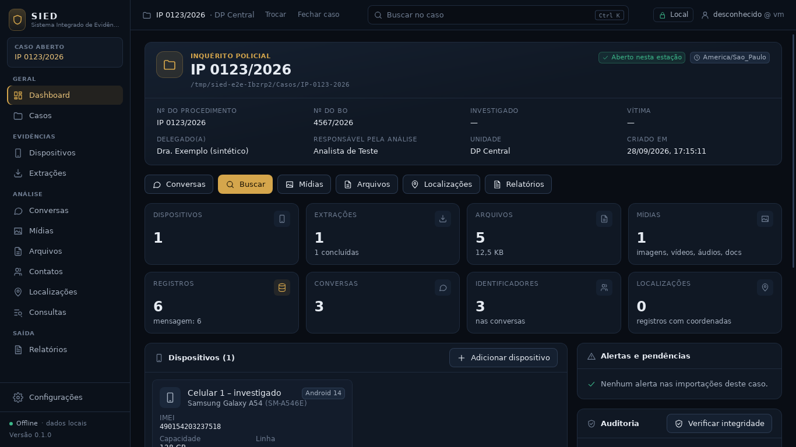
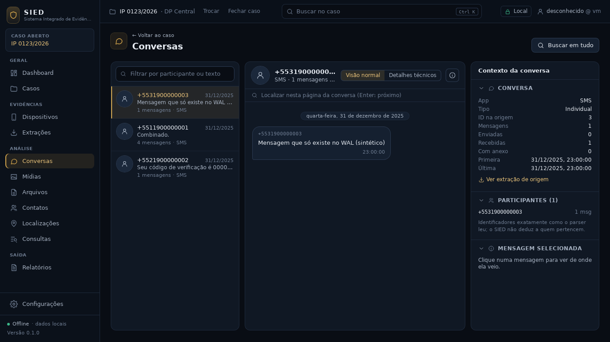
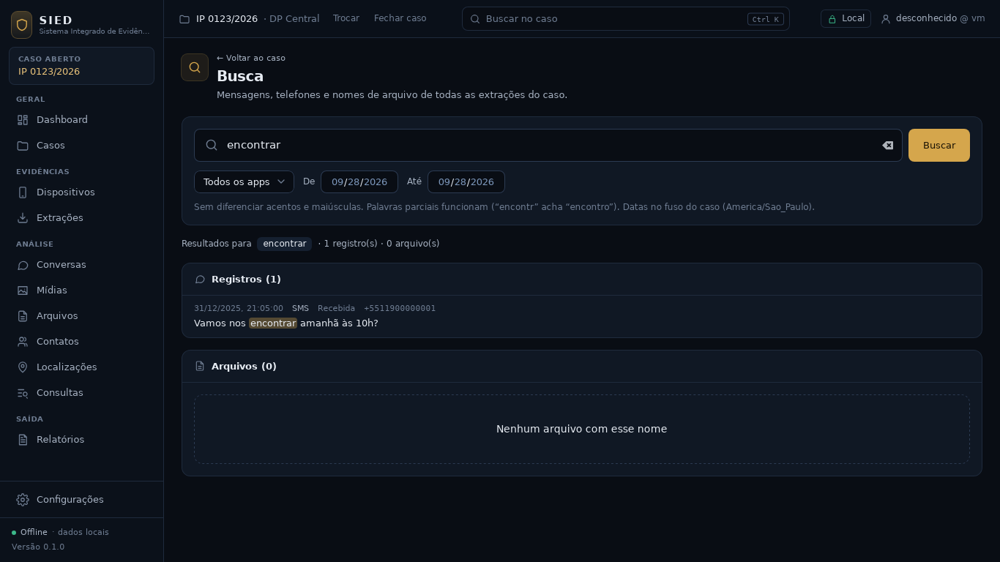
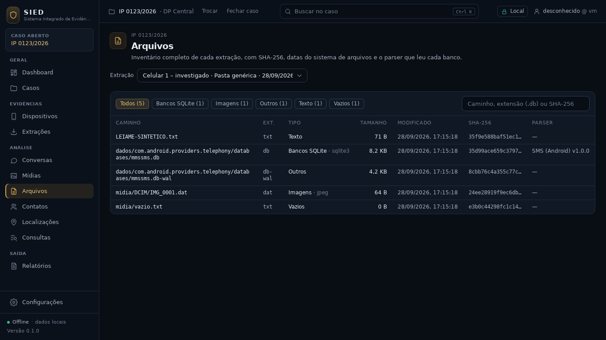
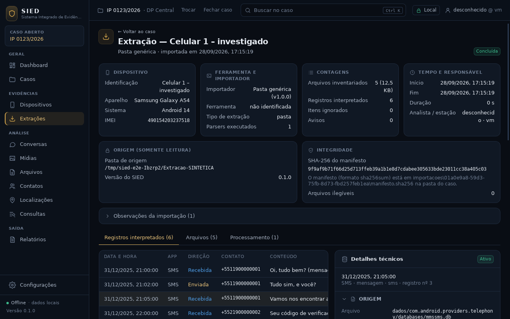
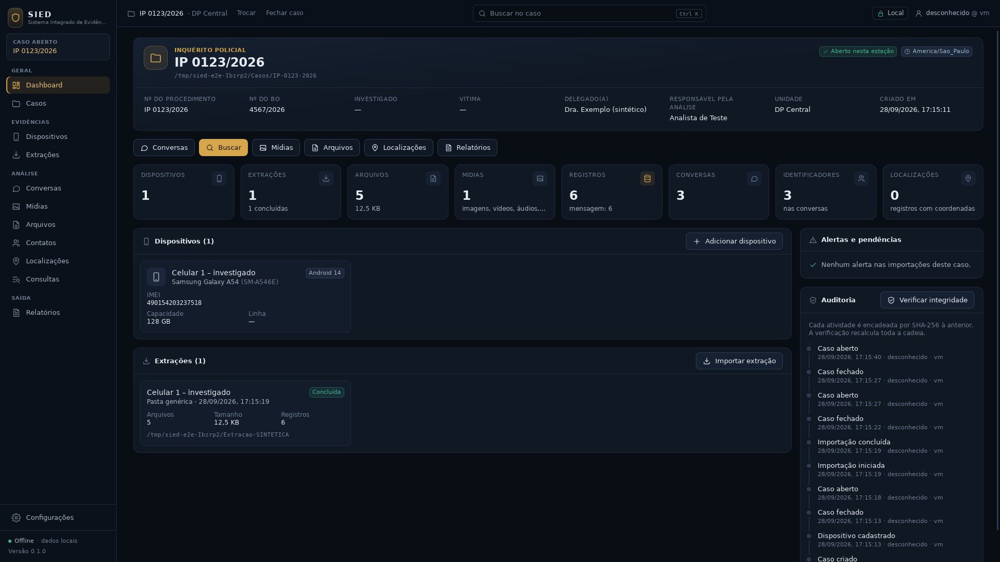

# Checkpoint — Redesign visual e de navegação

Data: 28/09/2026 · Branch `fase1-redesign` · PR #6, mesclado na `main` em `5e8e734`

Critério desta etapa: **evoluir a interface para um produto forense profissional (tema escuro,
navegação por módulos, Dashboard do caso, conversas em três colunas, busca, mídias, arquivos e
blocos técnicos) sem mudar backend, bancos, migrações, auditoria ou fluxos, sem remover testes e
sem exibir nenhum dado fictício.** Atendido e testado no app real.

A descrição completa da estrutura visual (tema, casca, componentes, rotas) está em
`docs/CONTINUIDADE.md` §15. Este arquivo registra o fechamento da etapa.

## Branch, commits e PR

| Commit | Descrição |
|---|---|
| `0317a3e` | Backend: resumo do caso e identificadores das conversas (somente leitura) |
| `ecc02ed` | Backend: categoria agrupadora `midia` no inventário |
| `64f6d27` | Interface: tema escuro, casca com 12 módulos, Dashboard e telas novas |
| `af482fb` | Testes da interface (barra lateral, indicadores, seções recolhíveis, Contatos, Mídias, formatação) |
| `9bbad7a` | Documentação: CONTINUIDADE §15 e README |
| `5e8e734` | Merge do PR #6 na `main` |

O registro deste checkpoint entrou por um PR próprio só de documentação (branch
`fase1-redesign-registro`).

## Testes

| Conjunto | Resultado |
|---|---|
| `cargo test --workspace` | 114 aprovados, 0 falhas (eram 110) |
| `cargo clippy -D warnings`, `cargo fmt --check` | limpos |
| Typecheck TypeScript e `vitest` | 23 aprovados, 0 falhas (eram 15) |
| `npm run build` e `tauri build --debug --no-bundle` | ok |
| Ponta a ponta no app real (`testes/e2e`) | aprovado, **mesmo roteiro, nenhuma verificação removida**; pasta da extração intacta |
| CI do PR #6 (execução 36477786100, em `9bbad7a`) | Testes (Linux) ✓, Testes (Windows) ✓, Instaladores Windows NSIS e MSI ✓ |
| CI da `main` em `5e8e734` (execução 36480177124) | Testes (Linux) ✓, Testes (Windows) em execução neste registro; instaladores pulados, como previsto em "Só tags" |

## Telas alteradas

Casca (barra lateral e cabeçalho), Casos, Novo caso, Dashboard do caso, Dispositivos, Extrações,
página da extração, assistente e progresso de importação, Conversas, Busca, e as novas Mídias,
Arquivos, Contatos, Localizações, Consultas, Relatórios e Configurações.

| Telas | |
|---|---|
|  |  |
|  |  |

As capturas usam só o caso sintético do teste ponta a ponta. As 29 capturas (13 telas nas duas
resoluções e 3 do roteiro) ficam fora do repositório, na pasta de arquivos do projeto.

## Componentes

- **Criados:** `Icone`, `BarraLateral`, `BarraSuperior`, `Indicador` (StatCard), `SecaoRecolhivel`,
  `Indisponivel`, `Abas`, `Filtros`, `LinkBotao`, `HashCurto`, `InventarioArquivos`,
  `SeletorExtracao`, `ConsoleImportacao`, `SecaoDispositivos`/`SecaoExtracoes` (modo compacto em
  cartões), páginas de módulos (`PaginasModulos.tsx`, `PaginasEstruturais.tsx`).
- **Reaproveitados com o tema novo, mesma API:** `Cabecalho`, `Cartao`, `Definicoes`, `Aviso`,
  `Carregando`, `Vazio`, `Selo`, `Hash`, `BarraProgresso`, `Paginacao`, `Botao`, `Campo`,
  `FormDispositivo`, `PainelTecnico` (reorganizado em blocos), `Importacao`.

## Funcionalidades

- **Preservadas:** criar/abrir/fechar caso, dispositivos, importação em segundo plano com
  cancelamento, extração com registros e origem técnica, conversas reconstruídas, busca FTS com
  telefone, "Abrir na conversa", verificação da trilha de auditoria. Todos os textos e seletores
  usados pelo ponta a ponta foram mantidos.
- **Novas na interface:** 12 módulos na barra lateral (desativados sem caso aberto), busca global
  do caso (Ctrl+K), indicador de importação em curso, Dashboard com 8 indicadores reais e alertas
  reais, conversas em 3 colunas com localizar na conversa e painel de contexto, busca com filtro de
  app e grupos, galeria de mídias e inventário de arquivos com painel de metadados, identificadores
  das conversas em Contatos, blocos técnicos recolhíveis na extração.
- **Só preparadas (estrutura, sem backend):** Localizações (mostra a contagem real de registros com
  coordenadas, hoje 0), Consultas, Relatórios, console técnico de importação (mostra só o estado que
  o backend já informa; o registro de eventos é o item §14.1 do roteiro).

## Estado por área

- **Avilla:** só contrato e fixtures sintéticas; aguarda a árvore de uma extração real.
- **WhatsApp:** leitor pausado, sem código; plano em `CONTINUIDADE.md` §13.
- **Busca:** pronta (texto, prefixo sem acento, telefone, arquivos, filtros de extração, app e período).
- **Conversas:** prontas para SMS; participantes como identificadores brutos até o WhatsApp e os contatos.
- **Mídias:** grade real do inventário, sem miniaturas nem reprodução.
- **Localizações:** estrutura; nenhum parser grava coordenadas ainda.
- **Relatórios:** estrutura; o PDF (Typst) ainda não existe.

## Limitações

Estão em `CONTINUIDADE.md` §6. As principais desta etapa: mídias sem miniatura, Mídias e Arquivos
mostram uma extração por vez, filtro de conversas atua na página carregada (100), sem virtualização
de listas, tema único, ícone do instalador ainda o anterior. **A imagem de referência citada no
pedido do redesign não chegou ao projeto**; o redesign seguiu a especificação escrita.

## Proteção do repositório

`.gitignore` conferido com `git check-ignore`: bancos, `.env`, chaves, pastas de casos, extrações e
relatórios, PDFs, contêineres e imagens forenses e backups do WhatsApp continuam bloqueados. Nenhum
arquivo sensível está versionado.

## Próximo passo recomendado

Parser WhatsApp Android numa branch nova a partir da `main` (plano em `CONTINUIDADE.md` §13),
depois de o usuário liberar. Em paralelo, quando chegar a árvore do Avilla, o importador Avilla.
