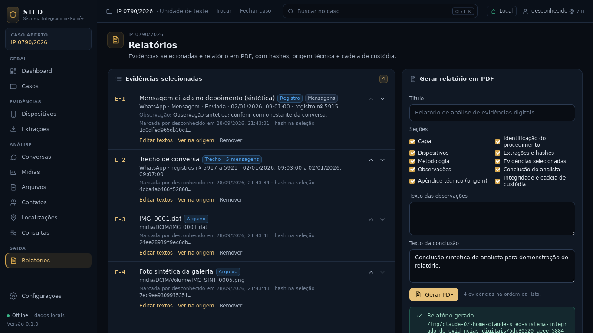
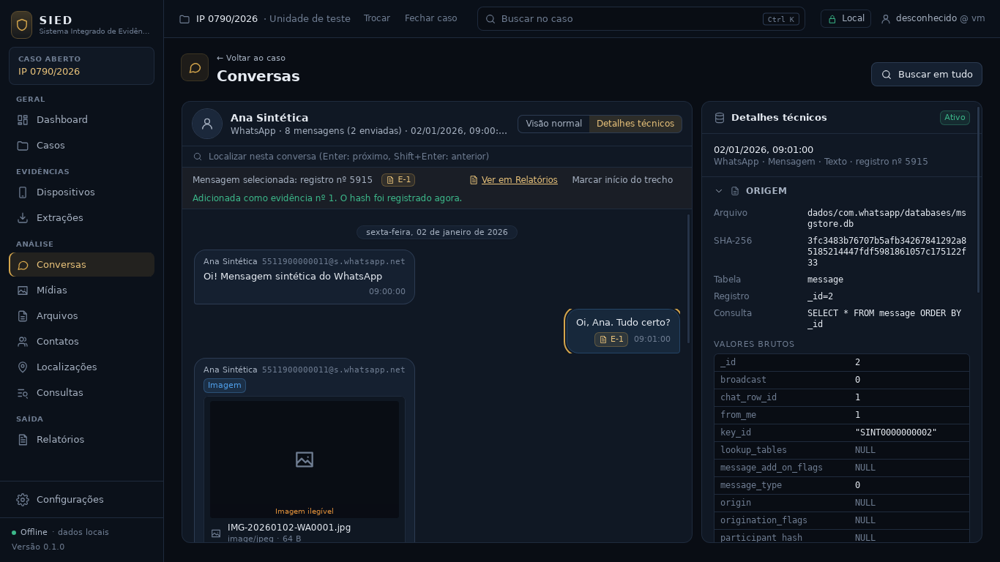
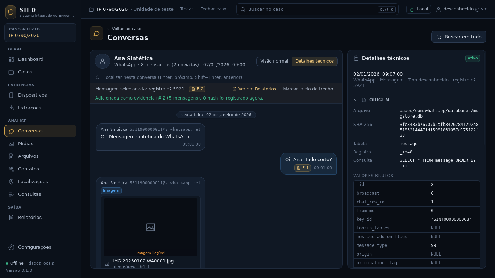
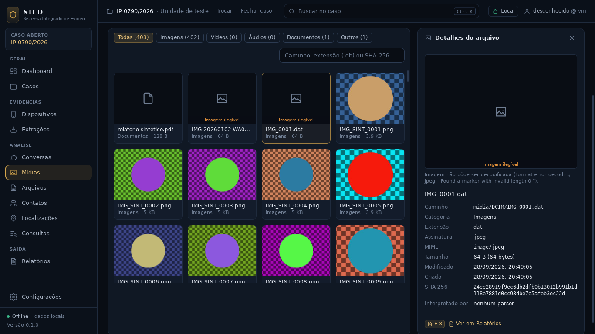
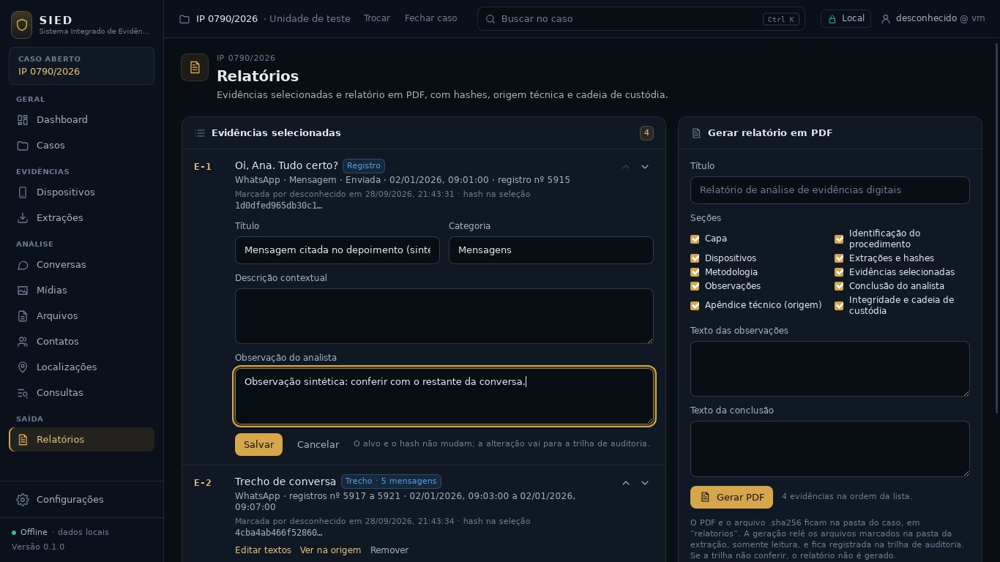
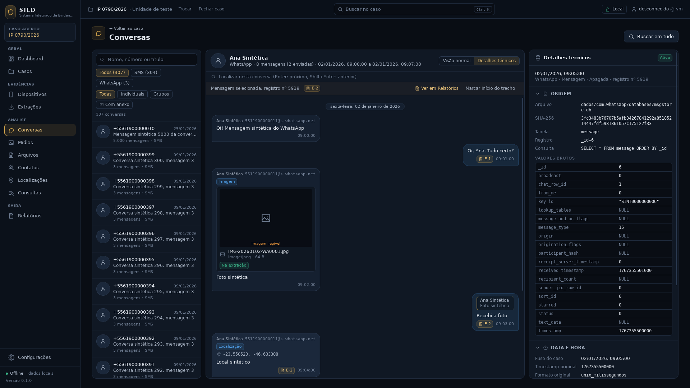
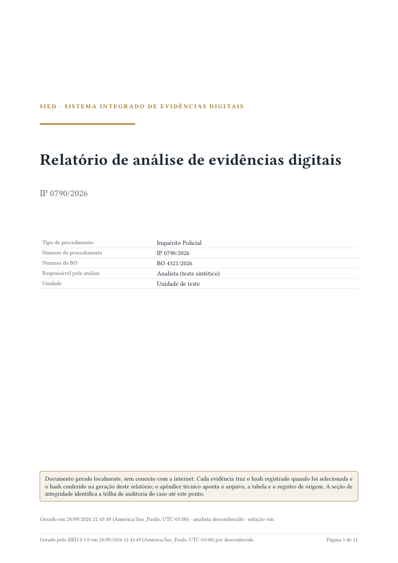
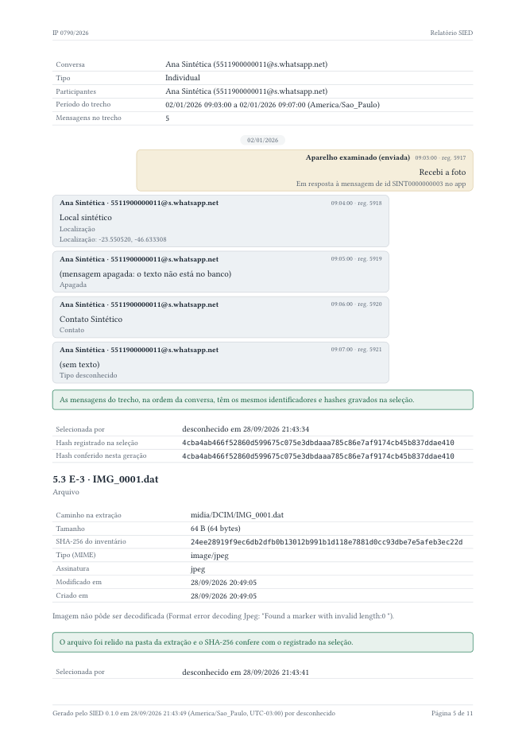
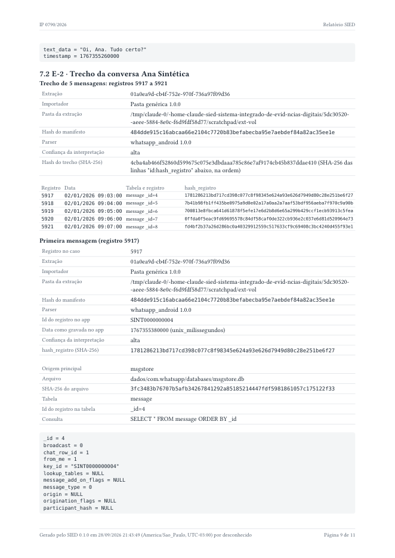
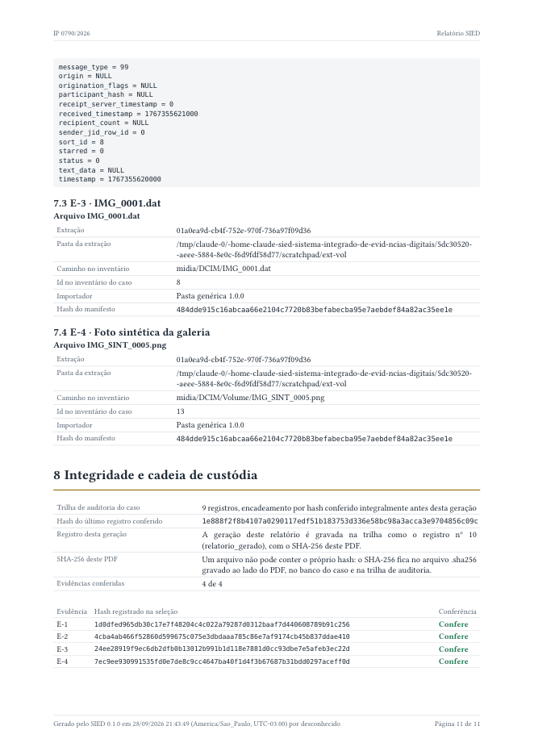

# Checkpoint — Evidências selecionadas e relatório PDF

Data: 29/09/2026 · Branch `fase1-evidencias-relatorio` (empilhada sobre `fase1-visual-volume`,
PR #9).

Critério desta etapa (pedido do usuário, "os 2 nesta ordem", parte 2): **o analista marca
evidências nas telas de análise (mensagem, trecho de conversa ou arquivo), organiza a lista e gera
um relatório PDF em Typst com hashes, origem completa de cada item e cadeia de custódia.** Atendido
e conferido no app real com a extração sintética do WhatsApp: 4 evidências (mensagem, trecho de 5
mensagens, foto da câmera e anexo), PDF de 11 páginas, integridade "4 de 4 conferem" e o arquivo
`.sha256` do PDF passando em `sha256sum -c`.



## IMPLEMENTADO

**Marcação de evidências** (migração 5 do banco do caso)
- Conversas: ao clicar numa mensagem aparece a barra "Evidência" com "Adicionar às evidências" e
  "Marcar início do trecho". Com o início marcado, a mensagem seguinte escolhida é o fim, e
  "Adicionar trecho às evidências" grava o trecho inteiro na ordem da conversa (as pontas podem
  ser escolhidas em qualquer ordem). "Cancelar trecho" desfaz a escolha.
- Arquivos e Mídias: "Adicionar às evidências" no detalhe do arquivo. Arquivo sem SHA-256 no
  inventário não pode ser marcado, e a tela diz por quê.
- Mensagens e arquivos marcados ganham o selo "E-n" (número no relatório) no chat e no detalhe,
  com o atalho "Ver em Relatórios".
- No momento da marcação o backend grava o hash do alvo: `hash_registro` do registro, SHA-256 do
  inventário para o arquivo, e para o trecho um SHA-256 calculado sobre as linhas
  `id:hash_registro` de cada mensagem, na ordem. O alvo e esse hash **nunca mudam** (gatilho).
- Recusas com motivo: a mesma coisa duas vezes ("isto já está nas evidências (nº n)"), trecho
  com pontas em conversas diferentes, trecho acima de 2.000 mensagens, arquivo sem SHA-256.
  Trecho de uma mensagem só vira evidência de registro.

**Lista de evidências** (módulo Relatórios, antes só estrutura)
- Cada item mostra número, tipo, título, categoria, quando e por quem foi marcado, o hash gravado e
  um resumo do alvo; "Subir E-n" e "Descer E-n" mudam a ordem (os números seguem a ordem).
- "Editar textos": título, categoria, descrição contextual e observação do analista.
- "Ver na origem": abre a conversa na mensagem marcada, ou a extração do arquivo.
- "Remover" pede um motivo opcional. A remoção é lógica: a linha fica no banco com quem removeu,
  quando e por quê, e sai da lista e do relatório.
- Cada ação (adicionar, alterar, reordenar, remover) entra na trilha de auditoria.

**Relatório PDF** (crate novo `sied-relatorio`, Typst 0.15.1 embutido)
- Formulário "Gerar relatório": título, 10 seções que podem ser ligadas ou desligadas (capa,
  procedimento, dispositivos, aquisição e importação, metodologia, evidências, observações,
  conclusão, apêndice técnico, integridade), texto das observações e da conclusão.
- Conteúdo:
  - capa com tipo e número do procedimento, BO, unidade, responsável pela análise, data de geração
    no fuso do caso, analista e estação;
  - dispositivos e extrações com importador, pasta, período, hash do manifesto e parsers
    executados;
  - metodologia (cópia verificada, somente leitura, hashes, fuso);
  - cada evidência com o conteúdo (conversa desenhada como chat, trecho com cabeçalho e período,
    arquivo com metadados e a imagem conferida), quem e quando selecionou, o hash registrado na
    seleção e o hash conferido nesta geração;
  - apêndice técnico com a origem completa de cada registro: extração, importador, parser e versão,
    arquivo e SHA-256, tabela, id na tabela, consulta usada e os valores brutos da linha;
  - quadro de integridade: uma linha por evidência com os dois hashes e "Confere" ou o problema;
  - cadeia de custódia: até que registro da trilha de auditoria o relatório vai e o hash final dela.
- Antes de gerar, o SIED **confere de novo** cada evidência: o registro no banco do caso, as
  mensagens do trecho (o hash é recalculado) e o arquivo, relido da pasta da extração em modo
  somente leitura. Resultados: "conferida"; "divergente", com um quadro vermelho de ATENÇÃO na
  evidência; ou "indisponível", quando a pasta da extração não está acessível (vale o SHA-256 do
  inventário).
- Se a trilha de auditoria não passa na verificação, o relatório **não é gerado** e a tela diz
  qual registro falhou.
- Imagens: só entram depois de o SHA-256 do arquivo conferir; reduzidas a 1.600 px. Imagem que não
  decodifica fica com o motivo no lugar da figura.
- Saída em `<pasta do caso>/relatorios/AAAA-MM-DD_HHMMSS_relatorio.pdf` (hora no fuso do caso;
  sufixo `-2`, `-3` se o nome já existe), gravada de forma atômica, com o
  `<nome>.pdf.sha256` ao lado (formato `sha256sum`). O PDF é registrado na tabela `relatorio`
  (somente inclusão) com seções, evidências e hashes, usuário, máquina, versão do SIED e a posição
  da trilha de auditoria; a geração entra na auditoria (`relatorio_gerado`).
- A tela mostra o caminho completo, o SHA-256, o tamanho e o resumo da conferência do PDF gerado,
  e lista os relatórios já gerados.
- Todo texto vindo da extração ou do analista entra no Typst como dado JSON, nunca como marcação:
  uma mensagem com `#` ou `*` aparece como texto.
- Fontes embutidas no binário (Libertinus Serif, DejaVu Sans Mono): nada é baixado.

## TESTES

| Conjunto | Antes (PR #9) | Agora | Resultado |
|---|---|---|---|
| Rust (`cargo test --workspace`) | 155 | 172 | todos passam |
| Interface (`vitest`) | 35 | 41 | todos passam |
| `cargo fmt --check`, `cargo clippy -D warnings`, `tsc` | — | — | limpos |
| Build da interface e do app (`tauri build --debug --no-bundle`) | — | — | ok |
| Ponta a ponta no app real (`testes/e2e`) | 1 roteiro | igual | passa; extração intacta |

Novos:
- `crates/sied-armazenamento/tests/evidencias.rs` (3): hash gravado por tipo (registro, trecho,
  arquivo), repetição recusada, reordenar, editar, remover com motivo e auditoria; trecho entre
  conversas diferentes recusado; gatilhos (alvo, hash e removida não mudam, nada é apagado).
- `crates/sied-relatorio/tests/relatorio.rs` (5): PDF, `.sha256`, registro, auditoria, sufixo `-2`
  no mesmo segundo, extração intacta e registro imutável; conteúdo do documento (fuso, extração,
  apêndice com valores brutos, trecho com uma linha por mensagem, figura conferida); foto trocada
  na extração vira "divergente" e pasta desconectada vira "indisponível"; trilha adulterada impede
  o relatório; caso sem evidências com seções desligadas.
- Exportação dos tipos TypeScript (9 tipos novos, testes gerados pelo ts-rs).
- `app/src/rotas/Evidencias.test.tsx` (6): mensagem, trecho e o selo E-n na bolha; recusa do
  backend na barra; arquivo pelo painel de detalhes; lista com reordenar, editar e remover com
  motivo; geração com as seções escolhidas mostrando caminho, SHA-256 e conferência; lista vazia
  explicando como marcar e relatórios já gerados.
- O caso sintético compartilhado pelos testes Rust fica em `testes/rust/caso_sintetico.rs`, com uma
  foto PNG sintética nova (`testes/fixtures/imagens/foto-sintetica.png`, marcada como sintética).

Nenhum teste existente foi removido. Os testes que simulam casos antigos
(`tests/importacao.rs` e `tests/whatsapp.rs`) passaram a desfazer também as tabelas da migração 5,
como já fazem com as migrações 3 e 4; as verificações são as mesmas. O roteiro do E2E é o mesmo.

## Telas do app real (extração sintética do WhatsApp)











## Páginas do PDF gerado pelo app










As 11 telas, as 11 páginas e o próprio PDF sintético (com o `.sha256`) estão em
`/mnt/project-files/sied/capturas/evidencias-relatorio/`. Nas capturas o usuário aparece como
"desconhecido" porque o ambiente de teste não tinha `USERNAME`/`USER`; no Windows é o usuário
do sistema.

## ARQUIVOS

- `crates/sied-armazenamento/migracoes/caso/0005_evidencias_relatorio.sql` (nova): tabelas
  `evidencia` e `relatorio` com gatilhos.
- `crates/sied-armazenamento/src/evidencias.rs`, `relatorios.rs` (novos); `conversas.rs`
  (`trecho`, `TRECHO_MAXIMO`); `caso.rs` (métodos do caso); `erro.rs` (`Recusado`);
  `migracoes.rs`; `tests/evidencias.rs` (novo).
- `crates/sied-relatorio/` (novo): `src/lib.rs` (gerar e gravar), `src/montagem.rs` (documento
  e conferência), `src/modelo.rs` (dados do documento), `src/modelo.typ` (modelo Typst),
  `src/motor.rs` (Typst embutido), `tests/relatorio.rs`.
- `crates/sied-midia/src/lib.rs`: `sha256_original` e imagem para o relatório.
- `app/src-tauri/src/{comandos,servico,erro,lib}.rs`: comandos de evidências e relatórios
  (`gerar_relatorio` é assíncrono).
- `app/src/api/{cliente,consultas}.ts`, `app/src/api/tipos/` (gerados).
- `app/src/componentes/Evidencias.tsx` (novo), `app/src/componentes/Arquivos.tsx`,
  `app/src/rotas/PaginaConversas.tsx`, `app/src/rotas/PaginaRelatorios.tsx` (novo),
  `app/src/rotas/PaginasEstruturais.tsx`, `app/src/main.tsx`, `app/src/rotas/Evidencias.test.tsx`
  (novo).
- `testes/rust/caso_sintetico.rs`, `testes/fixtures/imagens/foto-sintetica.png` (novos).
- `README.md`, `docs/CONTINUIDADE.md`, este checkpoint e `docs/checkpoints/evidencias-relatorio/`.

## DECISÕES

1. Evidência guarda o **hash do alvo no momento da seleção**; o relatório mostra esse hash e o
   conferido na geração, lado a lado. Alvo e hash são imutáveis por gatilho.
2. Trecho é identificado pelas pontas e pelo hash das linhas `id:hash_registro` das mensagens, na
   ordem da conversa. Mensagem nova no meio (outra importação) muda o hash e aparece como
   divergente.
3. Remoção lógica com motivo; o número "E-n" é a posição na lista atual. O PDF registra o id e o
   número de cada evidência incluída.
4. Relatório é somente inclusão: cada PDF gerado fica registrado com o SHA-256 e a posição da trilha
   de auditoria. Gerar de novo cria outro arquivo, nunca sobrescreve.
5. Trilha de auditoria quebrada impede a geração (um relatório com cadeia de custódia não pode sair
   de um caso cuja trilha não confere).
6. Typst embutido na aplicação, com fontes embutidas e acesso só aos arquivos que o SIED entrega
   (modelo, dados e imagens conferidas): o relatório sai offline e igual em qualquer estação.
7. Textos entram como dado, não como marcação Typst.
8. Datas no fuso do caso, com o nome e o deslocamento ("America/Sao_Paulo, UTC-03:00").
9. Arquivo relido da extração em somente leitura na geração; sem a pasta, "indisponível" em vez de
   falhar.

## PROBLEMAS

- A tabela do trecho ficava espremida; ganhou coluna "Tabela e registro" e hash em fonte menor.
- Título de apêndice sozinho no fim da página; agora fica preso ao conteúdo que o segue.
- O hash divergente de um arquivo aparecia truncado; a releitura passou a devolver o SHA-256
  completo e a comparação é a mesma para os três tipos.
- Rótulos da interface ambíguos entre as caixas de seção e os campos de texto; os campos passaram
  a "Texto das observações" e "Texto da conclusão".
- O disco do ambiente de build encheu com o Typst; resolvido limpando artefatos incrementais.

## COMO EXECUTAR

```
cd app && npm install && npm run tauri dev
python3 testes/gerador/extracao_sintetica.py --whatsapp C:\Temp\Extracao-SINTETICA
```

Importe a pasta, abra Conversas, clique numa mensagem e use a barra "Evidência"; em Mídias ou
Arquivos, use "Adicionar às evidências" no detalhe. Em Relatórios, organize a lista e clique em
"Gerar PDF". O PDF fica em `<pasta do caso>\relatorios\`. Para conferir fora do SIED, dentro dessa
pasta: `sha256sum -c <nome>.pdf.sha256`.

## COMO TESTAR

```
cargo fmt --all -- --check
cargo clippy --workspace --all-targets -- -D warnings
cargo test --workspace
cd app && npx tsc -p . && npm test && npm run build
cd app && npx tauri build --debug --no-bundle && cd .. && testes/e2e/executar.sh target/debug/sied-desktop
```

Para ver os PDFs dos testes: `SIED_RELATORIO_SAIDA=<pasta> cargo test -p sied-relatorio`.

## LIMITAÇÕES

- No máximo 60 figuras por relatório; a partir daí, a evidência traz os dados sem a imagem.
- Durante a geração os outros comandos do caso esperam (a geração usa a mesma trava do caso).
- Não há botão "Abrir PDF": a tela mostra o caminho completo para abrir pelo Explorer.
- A mensagem de imagem que não decodifica vem do decodificador (em inglês).
- O usuário é o do sistema operacional; não há login próprio no SIED.
- Um único modelo de relatório (`padrao-v1`); sem assinatura digital do PDF.
- Conferido só com dados sintéticos.

## PRÓXIMA FASE

Com esta etapa a fase 1 fecha o ciclo importar → analisar → selecionar → relatar. Próximo, na ordem
do §13 do `docs/CONTINUIDADE.md`: importador Avilla (quando a árvore de uma extração real
chegar), conferência do WhatsApp com um banco de aparelho de teste, agenda de contatos e chamadas
do Android e, depois, o console de importação em tempo real (§14.1).
