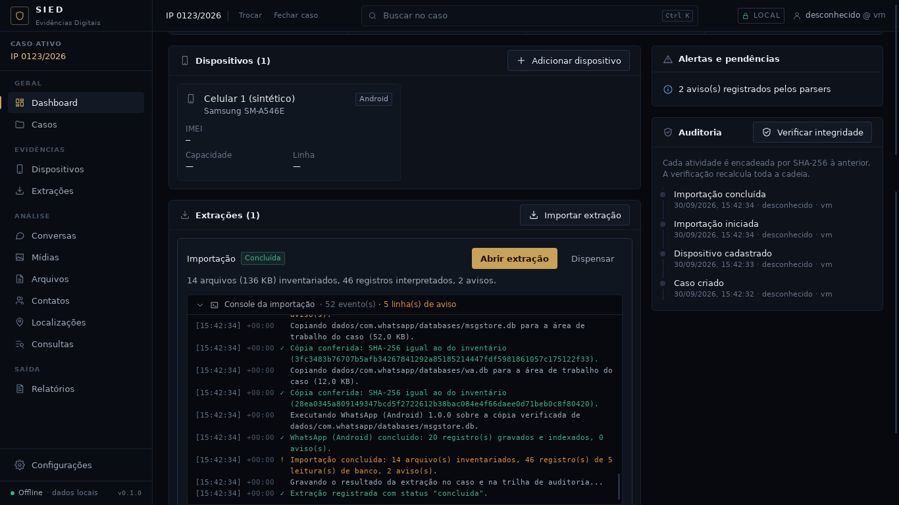

# Checkpoint — Console de importação em tempo real

Data: 30/09/2026 · Branch `claude/contatos-chamadas-android-z7m48s` (mesmo PR do MMS e da linha do
tempo). Item do roadmap registrado em 28/09/2026 (`docs/CONTINUIDADE.md` §14.1), escolhido pela
regra de construção contínua do usuário de 30/09.

Critério: **um console técnico dentro do SIED com eventos reais do backend (hash, cópia verificada,
importador e parsers, gravação e indexação, avisos, erros, tempo decorrido), recolhível, abaixo da
barra de progresso, sem animação simulada.** Atendido e conferido no app real com a extração
sintética `--whatsapp --android`: 50 eventos, do início ao "Extração registrada", e o mesmo console
reaberto depois na aba Processamento da extração; a pasta da extração ficou intacta.



## IMPLEMENTADO

- `crates/sied-ingestao/src/eventos.rs`: `EventoImportacao` (sequência, horário UTC em ms, nível
  info/ok/aviso/erro, mensagem em pt-BR), fila em memória (até 5.000 eventos, consulta de até
  1.000 por vez pela sequência) e leitura do log para reabrir o console.
- Pipeline: cada evento vai à fila do `Controle` **e** ao `log-importacao.jsonl` com os campos
  `mensagem` e `tom`. Eventos anunciados:
  - início (importador, versão, origem aberta só para leitura) e contagem (arquivos e bytes);
  - inventário: início do cálculo de SHA-256, marcos a cada 10% dos arquivos, cada banco SQLite
    localizado (até 30, depois um resumo), itens ignorados, arquivos ilegíveis, e o fim com
    totais e o SHA-256 do manifesto;
  - plano do importador (quantas leituras de banco);
  - para cada leitura: cópia para a área de trabalho, "Cópia conferida" com o SHA-256 (e dos
    auxiliares `-wal`/`-journal`), parser iniciado (nome, versão, arquivo), gravação a cada
    5.000 registros, avisos do parser (os 20 primeiros; todos continuam na lista de avisos da
    extração) e o fim com registros e avisos, ou a falha;
  - fim da importação (concluída, cancelada ou interrompida, com totais).
- Serviço do app: "Gravando o resultado da extração..." e "Extração registrada com status ..."
  (só ao vivo: acontecem depois que o log da importação foi fechado); comandos
  `eventos_importacao(desde)` e `eventos_da_extracao(id)`; `BancoCaso::eventos_da_importacao`.
- Interface (`app/src/componentes/ConsoleEventos.tsx`): console com horário no fuso do caso,
  decorrido desde o primeiro evento, marca e cor por nível, contagem de linhas de aviso e de
  erro, "ao vivo", rolagem que acompanha o fim enquanto o usuário não sobe, recolher/expandir
  acessível (`aria-expanded`, `role="log"`). Aparece aberto sob a barra de progresso, fechado no
  resultado (aberto se a importação não concluiu) e, fechado, na aba Processamento da extração.
  Substitui o espaço reservado que só listava o estado atual.

## TESTES REALIZADOS

| Verificação | Resultado |
|---|---|
| `cargo fmt --check`, `cargo clippy -D warnings` | limpos |
| `cargo test --workspace` | 239 passam, 0 falham, 3 medições ignoradas (+7: 3 de `eventos`, 2 ponta a ponta, 2 tipos exportados) |
| `npm run typecheck`, `npm test` (56), `npm run build` | limpos |
| Ponta a ponta `testes/e2e` (roteiro inalterado) | passa; extração intacta |
| Capturas no app real com `--whatsapp --android` | passa; extração intacta |

Testes novos: formatação pt-BR, fila (descarte dos mais antigos, consulta pela sequência),
releitura de log novo e antigo (linhas quebradas puladas); `tests/console.rs` (importação
completa: sequência contínua, ordem de horário, mensagens de cada passo, SHA-256 do manifesto no
console, fim "ok", consulta incremental, console relido do log igual ao ao vivo, extração
inexistente, origem intacta; e avisos do leitor de MMS aparecendo como aviso); dois testes de
interface (eventos pela sequência com horário, decorrido e nível; recolher e expandir). Nenhum
teste existente foi alterado.

## ARQUIVOS

- Novos: `crates/sied-ingestao/src/eventos.rs`, `crates/sied-armazenamento/tests/console.rs`,
  `app/src/componentes/ConsoleEventos.tsx`, `app/src/api/tipos/{EventoImportacao,NivelEvento}.ts`,
  `docs/checkpoints/console/` (capturas).
- Alterados: `sied-ingestao/src/{lib,pipeline}.rs`, `sied-armazenamento/src/caso.rs`,
  `app/src-tauri/src/{comandos,servico,lib}.rs`, `app/src/api/{cliente,consultas}.ts`,
  `app/src/componentes/Importacao.tsx` e seu teste, `app/src/rotas/PaginaExtracao.tsx`, `docs/`.

## DECISÕES

1. **Uma fonte só**: a mensagem mostrada é a mesma gravada no log da importação; reabrir o console
   é reler o log (logs antigos, sem `mensagem`, ganham uma descrição mínima pelo nome do evento).
2. Consulta incremental pela sequência a cada 500 ms (o mesmo ritmo do progresso), sem canal novo
   entre backend e interface.
3. Limites para extrações grandes: 30 bancos e 20 avisos por parser anunciados um a um, gravação
   anunciada a cada 5.000 registros, 5.000 eventos em memória. Nada disso reduz o que fica no banco
   do caso (inventário, avisos e execuções completos).
4. Sem migração; os eventos não entram na trilha de auditoria (que continua com início e fim da
   importação), ficam no log da importação ao lado do manifesto.

## PROBLEMAS

- Nenhum bloqueio. O clippy novo pediu `is_multiple_of` no lugar de `% n == 0`.

## COMO EXECUTAR

```
python3 testes/gerador/extracao_sintetica.py --whatsapp --android <pasta vazia>
cd app && npm run tauri dev
```
Importar a pasta: o console aparece sob a barra de progresso. Depois, Extrações → a extração →
aba Processamento → "Console da importação".

## COMO TESTAR

Os mesmos comandos de sempre (`docs/HANDOFF-CODEX.md` §29).

## LIMITAÇÕES

- Com a extração sintética a importação dura menos de um segundo; o acompanhamento "ao vivo"
  foi conferido pelos testes e pelo roteiro, não com uma extração grande real.
- As duas linhas finais (gravação do resultado) só aparecem ao vivo.
- Parsers externos (protocolo `progresso`/`aviso`) ainda não existem; quando existirem, as
  mensagens deles entram no mesmo registro.

## PRÓXIMA FASE

Importador IPED com fixtures sintéticas pelo formato público.
