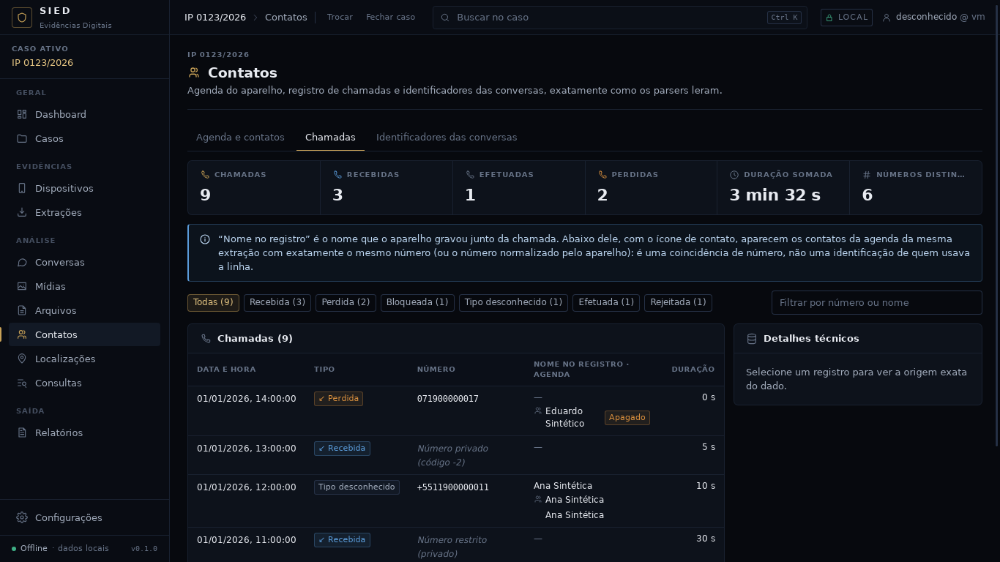

# Checkpoint — Agenda de contatos e registro de chamadas do Android

Data: 30/09/2026 · Branch `claude/contatos-chamadas-android-z7m48s` (a partir da `main` em
`132a8d5`, merge do PR #14, design system).

Critério desta etapa (próximo passo que não dependia do usuário, após "pode iniciar os próximos
passos"): **ler a agenda (`contacts2.db`) e o registro de chamadas (`calllog.db`) do Android no
modelo universal de artefatos, com rastreabilidade completa, e mostrar Contatos e Chamadas na
interface com dados reais do caso.** Atendido e conferido no app real com uma extração sintética
(`--whatsapp --android`): 9 contatos na lista (6 da agenda e 3 do WhatsApp), 9 chamadas, vínculo com a agenda, evidência marcada numa
chamada e pasta da extração intacta (hash e data de cada arquivo antes e depois).



## IMPLEMENTADO

**Leitor da agenda (`android_contatos` 1.0.0, papel `contacts2`)**
- Um artefato `contato` (app `contatos_android`) por **contato bruto** (`raw_contacts`): é assim
  que o Android guarda a agenda, uma linha por conta que sincroniza (Google, WhatsApp, aparelho).
  O agrupamento que o Android faz na tela não é refeito; o id do contato agrupado fica em
  `contato_id`.
- Conta (`accounts` pelo `account_id`, ou `account_name`/`account_type` nas versões antigas),
  telefones com tipo, rótulo e número normalizado pelo aparelho, e-mails, nome estruturado,
  apelido, empresa e cargo, observação, endereços, sites, favorito, vezes contatado, último
  contato. Outros tipos de dado (inclusive de apps, como o perfil do WhatsApp) vão em
  `outros_dados` com o mimetype e `data1`–`data3`.
- Origens: a linha de `raw_contacts` é a principal; cada linha de `data` interpretada, a conta e
  o contato agrupado entram como **origens adicionais**, cada uma com a linha inteira em valores
  brutos. A foto (BLOB) não é copiada; só o id da linha (`foto_registro`).
- `deleted=1` → estado "apagado". Linha de `data` órfã e mimetype desconhecido geram aviso.

**Leitor de chamadas (`android_chamadas` 1.0.0, papel `chamadas`)**
- Tabela `calls` de `calllog.db` (Android 7+) ou de `contacts2.db` (versões antigas). Sem a
  tabela: aviso e execução "parcial", nunca falha.
- Artefato `chamada` (app `telefone`): subtipo pelo `type` (recebida, efetuada, perdida,
  correio de voz, rejeitada, bloqueada, atendida em outro aparelho; código desconhecido vira
  "desconhecido" com o valor bruto nos metadados). `de_mim` só na efetuada; número em
  `remetente` (ou `destinatarios` na efetuada).
- Metadados: duração (negativa gera aviso), apresentação, recursos (vídeo, Wi-Fi, HD, VoLTE...),
  nome gravado junto da chamada, rótulo e tipo do número, normalizado, formatado, país,
  localização geocodificada, conta/chip, via número, dígitos pós-discagem, transcrição, nova,
  lida, modificado em.
- Códigos antigos no lugar do número (`-1`…`-4`) ficam em `numero_especial` e **não viram
  telefone**. `deleted=1` → estado "apagado". Data fora do intervalo plausível fica só no valor
  original.

**Importação**
- O importador genérico reconhece `contacts2.db` e `calllog.db`. `contacts2.db` sem
  `calllog.db` na mesma pasta também é entregue ao leitor de chamadas.
- Auxiliares de leitura comuns (`Linha`, `inteiro`, `texto`, `Auxiliar`, `referencia`,
  `Emissor`) saíram do módulo do WhatsApp para `parsers/comum.rs`, sem mudar comportamento.

**Consultas do caso** (`sied-armazenamento/src/agenda.rs`)
- `contatos` (agenda e contatos dos apps, sem grupos do WhatsApp; filtro por origem e por nome
  sem acento ou telefone pelos dígitos), `apps_contatos`, `chamadas` (filtro por tipo e por
  número ou nome, inclusive o nome do contato da agenda com o mesmo número) e `resumo_chamadas`.
- **Vínculo com a agenda calculado na consulta, nunca gravado**: mesma extração e igualdade
  exata dos dígitos do número ou do normalizado pelo aparelho. Aparece nas chamadas e nos
  identificadores das conversas que são telefone.
- Busca por telefone também acha contatos pelos telefones da agenda.
- Função SQL `sied_digitos` (só consultas). Sem migração nova.

**Interface** (módulo Contatos, mesma barra lateral de 12 módulos)
- Aba "Agenda e contatos": filtro por origem (Agenda, WhatsApp...) e por nome ou telefone; tabela
  com nome, telefones, origem e conta, situação (apagado, favorito, E-n); detalhe com telefones e
  "Ver chamadas" (abre a aba Chamadas filtrada pelo número).
- Aba "Chamadas": indicadores (total, recebidas, efetuadas, perdidas, duração somada, números
  distintos), filtro por tipo e por número ou nome, tabela com data, tipo, número (ou o motivo de
  não haver número), nome gravado e contatos da agenda com o mesmo número, duração; detalhe com
  apresentação, recursos, conta/chip e "Buscar o número no caso".
- Aba "Identificadores das conversas": a tabela anterior, com a coluna "Na agenda".
- Contato e chamada: "Adicionar às evidências" e painel técnico (arquivo, SHA-256, tabela,
  registro, valores brutos, origens adicionais, parser, hash do registro).
- Estado na URL (`?aba=`, `?q=`, `?registro=`): resultado de contato ou chamada na Busca abre
  direto em Contatos, no registro.
- Dashboard: o indicador de registros mostra os três tipos principais com o nome em português.

**Relatório PDF**
- Chamada: título "Chamada efetuada para X em …" / "Chamada recebida de X em …", campos Tipo,
  Número, Duração, Nome gravado, Recursos, Conta. Contato: título "Contato: Nome", Telefones (com
  tipo e rótulo), E-mails, Conta, Empresa. Conferência na geração igual às demais evidências.

**Ferramentas de teste**
- Fixtures SINTÉTICAS `testes/fixtures/android/` (`contacts2.sql`, `calllog.sql`, `LEIAME.md`),
  pela documentação pública do Android. Números de Ana e Bruno iguais aos da fixture do WhatsApp.
- `testes/gerador/extracao_sintetica.py --android` acrescenta `contacts2.db` e `calllog.db`.

## TESTES REALIZADOS

| Verificação | Resultado |
|---|---|
| `cargo fmt --all -- --check` | limpo |
| `cargo clippy --workspace --all-targets -- -D warnings` | limpo |
| `cargo test --workspace` | 222 passam, 0 falham, 3 medições ignoradas (eram 201; +12 testes novos e +9 exportações de tipos TS) |
| Tipos TS gerados (ts-rs) | 9 novos e 2 alterados, versionados |
| `npm run typecheck`, `npm test`, `npm run build` | limpos; 50 testes de interface (eram 43; +7) |
| `tauri build --debug --no-bundle` | ok |
| Ponta a ponta `testes/e2e/executar.sh` (roteiro inalterado) | passa; extração intacta |
| Roteiro de capturas no app real com `--whatsapp --android` | passa; extração intacta |

Testes novos:
- `android_chamadas` (5): fixture com 9 chamadas e todos os campos; sem tabela `calls`; colunas
  obrigatórias ausentes; valores estranhos (tipo 99, duração negativa, data absurda, número
  especial); cópia de trabalho inalterada.
- `android_contatos` (4): fixture completa (contas, telefones, apagado, perfil do WhatsApp, sem
  nome, órfão); esquema antigo com a conta na própria linha; banco sem as tabelas da agenda
  recusado; cópia inalterada.
- `agenda_chamadas.rs` (1, ponta a ponta no banco do caso): importação de duas extrações,
  listagens e filtros, vínculo só na mesma extração, número com máscara ligado pelo normalizado,
  contato apagado, restrito e código antigo sem vínculo, resumo, identificadores com agenda,
  busca por telefone, evidência de contato e chamada com hash conferido.
- Relatório (1): chamada e contato com campos próprios, PDF gerado.
- `so_digitos` (1) e plano do importador genérico (ampliado).
- Interface (7, `PaginaContatos.test.tsx`): agenda (lista, filtro por origem e texto, detalhe,
  evidência, "Ver chamadas"), estado vazio sem dados inventados, chamadas (resumo, tipos, número
  restrito, código antigo explicado, vínculo), filtros vindos da URL, registro aberto pela URL.

## ARQUIVOS

Novos:
- `crates/sied-ingestao/src/parsers/android_contatos.rs`, `android_chamadas.rs`, `comum.rs`
- `crates/sied-armazenamento/src/agenda.rs`, `tests/agenda_chamadas.rs`
- `testes/fixtures/android/` (`contacts2.sql`, `calllog.sql`, `LEIAME.md`)
- `app/src/rotas/PaginaContatos.tsx`, `PaginaContatos.test.tsx`
- `app/src/api/tipos/` (Chamada, ContatoAgenda, ContatoVinculado, FiltroChamadas, FiltroContatos,
  ResumoChamadas, TelefoneContato, TotalApp, TotalSubtipo)
- `docs/checkpoints/contatos-chamadas/` (10 capturas)

Alterados:
- `crates/sied-ingestao/src/importadores/generico.rs`, `parsers/mod.rs`,
  `parsers/whatsapp_android/comum.rs`, `registro.rs`
- `crates/sied-armazenamento/src/busca.rs`, `caso.rs`, `conexao.rs`, `extracoes.rs` (campo
  `conta` no detalhe), `lib.rs`, `resumo.rs`
- `crates/sied-relatorio/src/montagem.rs`, `tests/relatorio.rs`
- `app/src-tauri/src/comandos.rs`, `lib.rs`, `servico.rs` (4 comandos novos)
- `app/src/api/cliente.ts`, `consultas.ts`, `tipos/ArtefatoDetalhe.ts`, `tipos/Identificador.ts`
- `app/src/rotas/PaginasModulos.tsx`, `PaginaBusca.tsx`, `PaginaCaso.tsx`, `Modulos.test.tsx`
- `app/src/componentes/Evidencias.tsx`, `Icone.tsx`; `app/src/util/rotulos.ts`, `formatar.ts`
- `testes/gerador/extracao_sintetica.py`
- `docs/CONTINUIDADE.md`, `docs/HANDOFF-CODEX.md`

## DECISÕES

1. **Dois parsers**, um por banco. O de chamadas lê a tabela `calls` onde ela estiver; o
   importador decide qual banco entregar.
2. **Um contato por contato bruto**, sem refazer o agrupamento do Android nem juntar contatos
   repetidos: o perito vê exatamente o que cada conta gravou.
3. **Vínculo com a agenda só na consulta e só por igualdade exata de dígitos na mesma extração.**
   Nada é gravado, nada é deduzido por semelhança, e a tela diz que é coincidência de número, não
   identificação de quem usava a linha.
4. **Chamadas como aba de Contatos**, não módulo novo: o redesign aprovado fixa 12 módulos na
   barra lateral (há teste para isso).
5. **Sem migração**: os índices existentes (`idx_artefato_extracao` por tipo) bastam.
6. Código antigo no lugar do número (`-2` etc.) fica fora do campo de telefone para não criar
   vínculos nem buscas falsas; a tela explica o código.

## PROBLEMAS

- Nenhum bloqueio. Ajustes durante a etapa: a tabela de chamadas cortava a coluna de duração em
  1366 px (nome gravado e agenda passaram a dividir uma coluna, e o painel lateral ficou mais
  estreito abaixo de 1536 px); a tela mostrava "Número apresentado" numa chamada sem número com
  código `-2` (o código passou a chegar à tela e é explicado).
- No container Linux faltavam bibliotecas GTK/WebKit para compilar o app; instaladas só no
  ambiente de trabalho (nada no repositório).

## COMO EXECUTAR

```
git fetch origin && git checkout claude/contatos-chamadas-android-z7m48s
cd app && npm ci && npm run tauri dev
python3 testes/gerador/extracao_sintetica.py --whatsapp --android <pasta vazia>
```
No SIED: criar caso, cadastrar dispositivo, "Importar extração" com a pasta gerada, depois
Contatos (abas Agenda, Chamadas, Identificadores).

## COMO TESTAR

```
cargo fmt --all -- --check
cargo clippy --workspace --all-targets -- -D warnings
cargo test --workspace
git diff --exit-code -- app/src/api/tipos
cd app && npm run typecheck && npm test && npm run build
cd app && npx tauri build --debug --no-bundle && cd .. && testes/e2e/executar.sh target/debug/sied-desktop
```

## LIMITAÇÕES

- Conferido só com fixtures sintéticas montadas pela documentação pública
  (`ContactsContract`, `CallLog.Calls`); falta conferir com bancos de um aparelho de teste
  (fabricantes acrescentam colunas; colunas desconhecidas ficam nos valores brutos).
- Não lidos: fotos dos contatos, `deleted_contacts`, grupos da agenda, chamadas de apps
  (WhatsApp, Telegram), MMS, correio de voz em áudio.
- Contatos repetidos em contas diferentes não são juntados (de propósito).
- O vínculo não reconhece o mesmo número escrito com e sem DDI/DDD quando o aparelho não gravou
  o normalizado (ex.: `11 90000-0012` e `+55 11 90000-0012` só ligam pelo `data4`/
  `normalized_number`).
- Listas de contatos e chamadas paginadas de 100, como Arquivos.

## PRÓXIMA FASE

Esta etapa termina aqui, sem merge (exige aval). Na ordem recomendada:
1. importador Avilla, quando a árvore de uma extração real chegar;
2. conferência do WhatsApp, da agenda e das chamadas com bancos de aparelho de teste;
3. console de importação em tempo real (`docs/CONTINUIDADE.md` §14.1).
