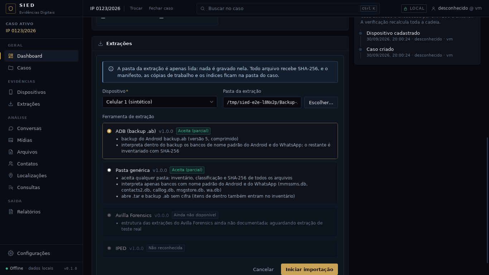
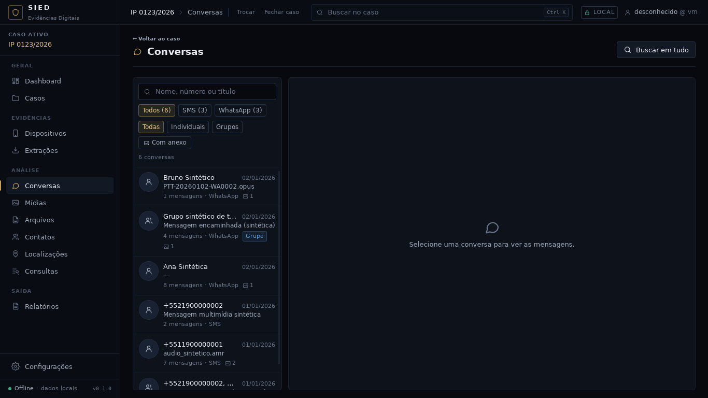

# Checkpoint — Importador ADB (backup .ab e .tar sem extrair)

Data: 30/09/2026 · Branch `claude/contatos-chamadas-android-z7m48s`, reiniciada da `main` depois do
merge do PR #16 (`b6da666`). Próxima fase da ordem do roteiro (Avilla → IPED → **ADB** → ALEAPP →
iLEAPP), em construção contínua.

Critério: **importar um backup gerado por `adb backup` (`.ab`) sem extrair nada para o disco, com
cada item de dentro no inventário com SHA-256 e os bancos lidos pelos mesmos parsers.** Atendido e
conferido no app real com o backup sintético (`--adb`): o ADB aparece primeiro no assistente, 10
arquivos (o backup e 9 itens de dentro) entram no inventário, 45 registros e 6 conversas (3 SMS, 3
WhatsApp) vêm de dentro do backup, e a pasta de origem ficou intacta.



## IMPLEMENTADO

- Formato público do Android (AOSP): cabeçalho `ANDROID BACKUP`, versão, compressão (zlib) e cifra;
  depois um tar com `apps/<pacote>/{_manifest,db,f,sp,r}`.
- `crates/sied-ingestao/src/fonte/conteiner.rs`: leitura em fluxo de tar (ustar com prefixo, nome
  longo GNU, pax, checksum conferido, tamanho em base-256) e do `.ab`; backup cifrado recusado.
- `PastaSomenteLeitura` lista e abre itens de `.tar` e `.ab` com o caminho
  `backup.ab!/apps/<pacote>/db/<banco>` (separador `!/` já previsto na arquitetura). Duplicados,
  nomes inseguros, links, itens especiais, backup cifrado e erro no meio do contêiner viram item
  ignorado com o motivo. Um cursor por contêiner evita descomprimir de novo a cada item.
- `crates/sied-ingestao/src/importadores/adb.rs` (`adb`, "ADB (backup .ab)"): detecção pelo
  cabeçalho; observações com cada backup e cada `_manifest` (pacote, versão do app, API do
  Android); bancos de nome padrão (SMS/MMS, agenda, chamadas, WhatsApp) para os leitores de sempre.
  Backup cifrado: só inventário, com observação.
- A pasta genérica também abre `.tar` e `.ab`; a detecção usa `listar_sem_conteineres` (rápida).
- Gerador `--adb` (backup sintético com os bancos SQL das fixtures).


## TESTES REALIZADOS

| Verificação | Resultado |
|---|---|
| `cargo fmt --check`, `cargo clippy -D warnings` | limpos |
| `cargo test --workspace` | 257 passam, 0 falham, 3 medições ignoradas (+9) |
| `npm run typecheck`, `npm test` (56), `npm run build` | limpos |
| Ponta a ponta `testes/e2e` (roteiro inalterado) | passa; extração intacta |
| Capturas no app real com `--adb` | passa; origem intacta |

Testes novos: tar com nome longo e pax, cabeçalho do `.ab`, backup comprimido e não comprimido
(`conteiner.rs`); listagem e leitura por dentro, backup cifrado inventariado sem abrir
(`pasta.rs`); manifesto, detecção e plano, pasta sem backup (`adb.rs`); `tests/adb.rs` (backup de
ponta a ponta: detecção pelo registro, SHA-256 de cada item de dentro igual ao do conteúdo, 5
parsers com caminhos de dentro, conferência do registro, observação do manifesto, origem intacta).
Nenhum teste existente foi alterado.

## ARQUIVOS

- Novos: `crates/sied-ingestao/src/{fonte/conteiner,importadores/adb}.rs`,
  `crates/sied-armazenamento/tests/adb.rs`, `testes/rust/backup_sintetico.rs`,
  `docs/checkpoints/adb/` (capturas).
- Alterados: `Cargo.toml` (flate2), `sied-ingestao/src/{fonte,fonte/pasta,registro,
  importadores/mod,importadores/generico}.rs`, `testes/gerador/extracao_sintetica.py`, `docs/`.

## DECISÕES

1. Nada é extraído para o disco: a fonte lê por dentro, e o pipeline copia e confere o item como
   faz com qualquer arquivo. O caminho `arquivo.ab!/...` fica na origem de cada registro.
2. Backup cifrado não é aberto (a senha seria uma credencial); fica no inventário com o hash.
3. Contêiner dentro de contêiner e `.zip` ficam para depois (só inventário).
4. `LeitorFonte` deixou de exigir `Seek` (ninguém usava; o fluxo do tar não permite).
5. Sem migração; nenhum tipo novo no domínio.

## PROBLEMAS

- Nenhum bloqueio.

## COMO EXECUTAR

```
python3 testes/gerador/extracao_sintetica.py --adb <pasta vazia>
cd app && npm run tauri dev
```
Importar a pasta: o assistente propõe o ADB. As conversas aparecem em Conversas; os itens de dentro
do backup, na aba Arquivos da extração.



## COMO TESTAR

Os mesmos comandos de sempre (`docs/HANDOFF-CODEX.md` §29).

## LIMITAÇÕES

- Conferido só com backup sintético.
- `f/`, `sp/` e `shared/` do backup só inventariados; a API do Android lida no `_manifest` ainda
  não é gravada como atributo do aparelho.
- Ler itens fora de ordem num contêiner grande comprimido é lento (recomeça do início).

## PRÓXIMA FASE

Importadores ALEAPP e iLEAPP pelo formato público dos relatórios; Avilla quando a árvore real
chegar.
