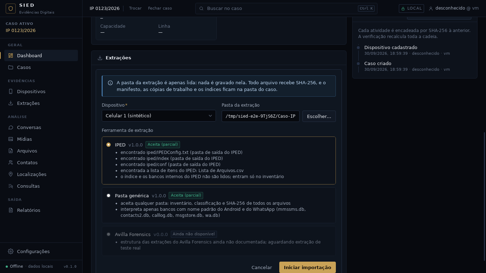

# Checkpoint — Importador IPED (lista de itens)

Data: 30/09/2026 · Branch `claude/contatos-chamadas-android-z7m48s` (mesmo PR do MMS, da linha do
tempo e do console). Próxima fase da ordem de construção contínua do usuário de 30/09.

Critério: **reconhecer a pasta de um caso processado pelo IPED e ler os itens do caso pelo
formato público, sem inventar estrutura, com fixtures sintéticas.** Atendido e conferido no app
real com o caso sintético (`--iped`): o IPED aparece primeiro no assistente, 5 itens viram
registros "arquivo", os dois exportados são ligados ao inventário pelo caminho exato, e a pasta
do caso ficou intacta.



## IMPLEMENTADO

- Formato conferido no código-fonte público do IPED (projeto sepinf-inc/IPED: `ExportCSVTask`,
  `ExportFileTask`, `Util.concatStrings` e os arquivos `iped-engine-messages*.properties`).
- `crates/sied-ingestao/src/parsers/iped_lista.rs` (`iped_lista_arquivos`, papel `lista_iped`):
  - cabeçalho com 15 colunas e `MD5`, `SHA1`, `TrackId` nas posições fixas (nomes das demais
    mudam com o idioma), separador `;` ou `,`, BOM, CRLF, aspas dobradas, campo que continua na
    linha seguinte;
  - um registro "arquivo" por linha: nome, tamanho, TrackId como identificador, subtipo "item"
    ou "recuperado" (carving), estado apagado, metadados (caminho na evidência, extensão, MD5 e
    SHA1 calculados pelo IPED, marcadores e categorias separados por " | ", as três datas com o
    valor original e, quando possível, em UTC) e a linha inteira em `valores_brutos` com os
    nomes do cabeçalho;
  - datas de `java.util.Date.toString()`: convertidas só com fuso inequívoco (`UTC`, `GMT`,
    `GMT-03:00`, `BRT`, `BRST`, `FNT`); qualquer outra abreviação fica no original, com um aviso
    que lista as abreviações;
  - atalho `=HIPERLINK("Exportados\arquivos\...";"Abrir")` (ou `HYPERLINK`, em qualquer idioma)
    vira o caminho do anexo, ligado ao inventário pelo caminho exato;
  - linha com colunas a mais ou a menos, tamanho não numérico e data ilegível viram aviso, sem
    parar a leitura.
- `crates/sied-ingestao/src/importadores/iped.rs` (`iped`, "IPED"):
  - detecção por `iped/IPEDConfig.txt`, `iped/index`, `iped/conf` e pela lista na raiz (6 nomes,
    um por idioma, só com cabeçalho válido); sempre `Parcial`, com o motivo;
  - plano: a lista de itens, mais os bancos de nome padrão do Android e do WhatsApp fora de
    `iped/` (por exemplo, exportados); a pasta `iped/` entra só no inventário, com observação.
- Rótulos na interface e no relatório: "IPED (lista de itens)", "Arquivo", "Item do caso",
  "Recuperado (carving)". Na lista de registros da extração, a coluna Conteúdo mostra o nome do
  arquivo quando o registro não tem texto (antes mostrava o TrackId na coluna Contato).
- Fixtures sintéticas em `testes/fixtures/iped/` (caso em português e lista em inglês) com
  `-text` em `.gitattributes`; gerador `--iped`.

## TESTES REALIZADOS

| Verificação | Resultado |
|---|---|
| `cargo fmt --check`, `cargo clippy -D warnings` | limpos |
| `cargo test --workspace` | 248 passam, 0 falham, 3 medições ignoradas (+9) |
| `npm run typecheck`, `npm test` (56), `npm run build` | limpos |
| Ponta a ponta `testes/e2e` (roteiro inalterado) | passa; extração intacta |
| Capturas no app real com `--iped` | passa; caso intacto |

Testes novos: separação de campos, datas do Java e atalho/listas (unitários do parser);
detecção com e sem lista, recusa de CSV qualquer e plano (unitários do importador);
`tests/iped.rs` (caso em português de ponta a ponta com detecção pelo registro, vínculo com os
exportados, metadados, apagado, recuperado, fuso ambíguo com aviso, conferência de cada
registro e origem intacta; lista em inglês sem a pasta do caso; linhas com problema viram aviso).
Nenhum teste existente foi alterado.

## ARQUIVOS

- Novos: `crates/sied-ingestao/src/{parsers/iped_lista,importadores/iped}.rs`,
  `crates/sied-armazenamento/tests/iped.rs`, `testes/fixtures/iped/`, `.gitattributes`,
  `docs/checkpoints/iped/` (capturas).
- Alterados: `sied-ingestao/src/{registro,parsers/mod,importadores/mod}.rs`,
  `sied-relatorio/src/montagem.rs`, `app/src/util/rotulos.ts`, `app/src/rotas/PaginaExtracao.tsx`,
  `testes/gerador/extracao_sintetica.py`, `docs/`.

## DECISÕES

1. Só a lista de itens em CSV é lida: é o formato de troca documentado pelo próprio IPED. O
   índice Lucene e os bancos internos mudam com a versão e não são lidos.
2. MD5 e SHA1 do IPED ficam como metadados do item (o SIED continua calculando SHA-256 de tudo o
   que está na pasta); não são comparados automaticamente nesta versão.
3. Fuso só é convertido quando não há ambiguidade; "não sei" é melhor que inventar.
4. Sem migração; nenhum tipo novo no domínio (usa o tipo "arquivo" que já existia).

## PROBLEMAS

- Nenhum bloqueio. O repositório do IPED foi lido por clone anônimo (a API do GitHub fora do
  escopo do projeto não é usada).

## COMO EXECUTAR

```
python3 testes/gerador/extracao_sintetica.py --iped <pasta vazia>
cd app && npm run tauri dev
```
Importar a pasta: o assistente propõe o IPED. Os itens aparecem em Consultas (linha do tempo) e
na lista de registros da extração.

## COMO TESTAR

Os mesmos comandos de sempre (`docs/HANDOFF-CODEX.md` §29).

## LIMITAÇÕES

- Conferido só com o caso sintético montado pelo código-fonte público, não com um caso real.
- Os itens não exportados ficam só como registro (não há arquivo para abrir).
- A versão do IPED não é identificada (o formato não traz um campo confiável).

## PRÓXIMA FASE

Importador Avilla, quando a árvore real chegar; enquanto isso, conferências com dados de teste
e dívida técnica medida.
