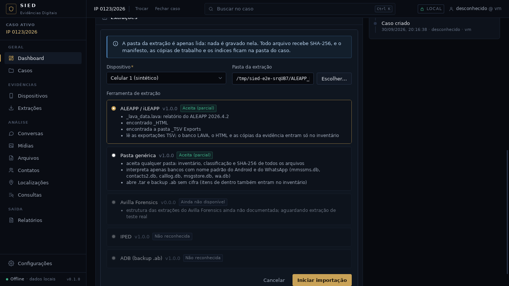
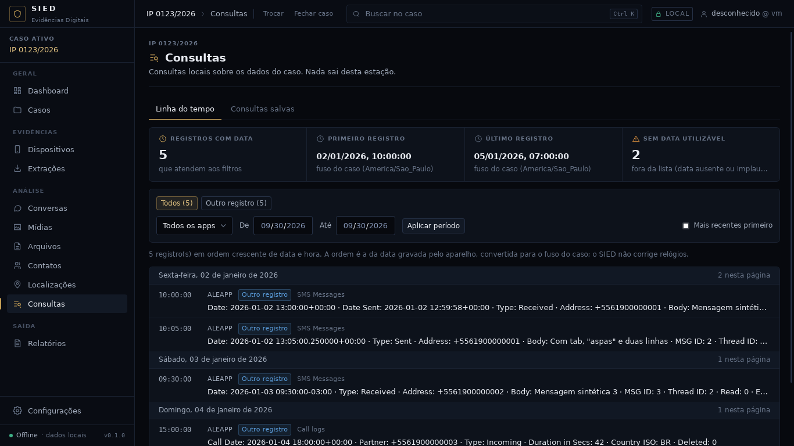
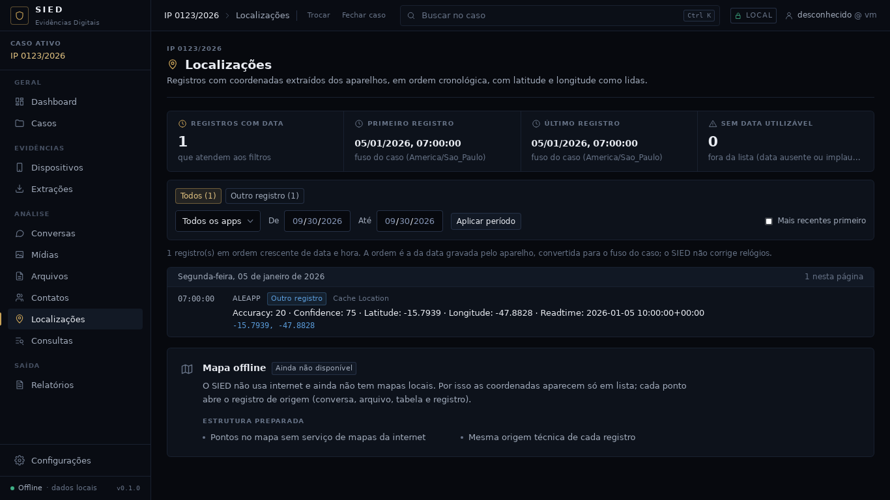

# Checkpoint — Importador ALEAPP / iLEAPP (exportações TSV)

Data: 30/09/2026 · Branch `claude/contatos-chamadas-android-z7m48s`, depois do importador ADB
(PR #17). Próxima fase do roteiro (Avilla → IPED → ADB → **ALEAPP → iLEAPP**), em construção
contínua.

Critério: **reconhecer a pasta do relatório do ALEAPP ou do iLEAPP e ler os artefatos pelo formato
público, sem inventar estrutura, com fixtures sintéticas.** Atendido e conferido no app real com o
relatório sintético (`--leapp`): o importador aparece primeiro no assistente com "relatório do
ALEAPP 2026.4.2", 7 linhas viram registros na linha do tempo e em Localizações, e a pasta ficou
intacta.



## IMPLEMENTADO

- Formato conferido no código-fonte público dos dois projetos (abrignoni/ALEAPP e
  abrignoni/iLEAPP: `scripts/ilapfuncs.py`, função `tsv`, igual nos dois; `scripts/lavafuncs.py`,
  projeto `_lava_data.lava`; `aleapp.py`, pastas do relatório).
- `crates/sied-ingestao/src/parsers/leapp_tsv.rs` (`aleapp_tsv`, `ileapp_tsv`, `xleapp_tsv`;
  papel `tsv_leapp`):
  - TSV do `csv.writer` do Python (TAB, aspas só quando preciso, campo com quebra de linha, BOM,
    CRLF) e o cabeçalho repetido quando o módulo grava duas vezes (com outro BOM, no ALEAPP);
  - um registro "outro" por linha: subtipo = nome do artefato, resumo "coluna: valor" em
    `conteudo`, linha inteira em `valores_brutos`, `tabela` = nome do artefato;
  - data da primeira coluna (como a linha do tempo do próprio xLEAPP) ou, se não for data, da
    primeira coluna com "date"/"time" no nome; convertida só com fuso explícito;
  - `Latitude`/`Longitude` (as colunas que o mapa do xLEAPP usa) viram coordenadas; 0,0 não.
- `crates/sied-ingestao/src/importadores/leapp.rs` (`leapp`, "ALEAPP / iLEAPP"): detecção pelo
  projeto, `_HTML`, `_lava_artifacts.db`, `_Timeline` e `_TSV Exports`; a ferramenta e a versão
  do projeto vão para "Ferramenta" da extração e escolhem o parser; observações com a entrada
  original e o tipo de entrada.
- Rótulos: "ALEAPP", "iLEAPP", "ALEAPP/iLEAPP" e "Outro registro" na interface e no relatório.
- Fixtures sintéticas em `testes/fixtures/leapp/` gravadas por `montar.py` com o próprio
  `csv.writer` do Python (`-text` no `.gitattributes`); gerador `--leapp`.



## TESTES REALIZADOS

| Verificação | Resultado |
|---|---|
| `cargo fmt --check`, `cargo clippy -D warnings` | limpos |
| `cargo test --workspace` | 265 passam, 0 falham, 3 medições ignoradas (+8) |
| `npm run typecheck`, `npm test` (56), `npm run build` | limpos |
| Ponta a ponta `testes/e2e` (roteiro inalterado) | passa; extração intacta |
| Capturas no app real com `--leapp` | passa; relatório intacto |

Testes novos: campos do csv do Python, datas com e sem fuso, resumo (unitários do parser);
projeto LAVA, detecção e plano por ferramenta, só TSV e pasta comum (unitários do importador);
`tests/leapp.rs` (relatório do ALEAPP de ponta a ponta: detecção pelo registro, fuso convertido,
campo com TAB/aspas/quebra de linha, cabeçalho repetido, data sem fuso com aviso, coordenadas,
coluna de data fora da primeira, conferência de cada registro e origem intacta; relatório do
iLEAPP). Nenhum teste existente foi alterado.

## ARQUIVOS

- Novos: `crates/sied-ingestao/src/{parsers/leapp_tsv,importadores/leapp}.rs`,
  `crates/sied-armazenamento/tests/leapp.rs`, `testes/fixtures/leapp/`, `docs/checkpoints/leapp/`.
- Alterados: `sied-ingestao/src/{registro,parsers/mod,importadores/mod}.rs`,
  `sied-relatorio/src/montagem.rs`, `app/src/util/rotulos.ts`, `.gitattributes`,
  `testes/gerador/extracao_sintetica.py`, `docs/`.

## DECISÕES

1. Só as exportações TSV são lidas: é o formato que os dois projetos gravam igual há mais tempo.
   O banco LAVA muda com a versão do esquema.
2. Cada linha fica como "outro registro", com o nome do artefato: transformar "SMS Messages" em
   mensagens do SIED exige conferir coluna por coluna em cada versão; fica para depois.
3. Data sem fuso não entra na linha do tempo ("não sei" é melhor que inventar).
4. Um parser por ferramenta, com o mesmo código, para a execução dizer se foi ALEAPP ou iLEAPP.
5. `data/` (cópia da evidência feita pela ferramenta) e `media/` só no inventário; para
   interpretar os bancos originais, importe a extração em si.
6. Sem migração; nenhum tipo novo no domínio.

## PROBLEMAS

- Nenhum bloqueio. Os repositórios públicos foram lidos por clone anônimo.

## COMO EXECUTAR

```
python3 testes/gerador/extracao_sintetica.py --leapp <pasta vazia>
cd app && npm run tauri dev
```
Importar a pasta: o assistente propõe "ALEAPP / iLEAPP". Os registros aparecem em Consultas
(linha do tempo), em Localizações (quando têm coordenadas) e na lista de registros da extração.



## COMO TESTAR

Os mesmos comandos de sempre (`docs/HANDOFF-CODEX.md` §29).

## LIMITAÇÕES

- Conferido só com relatórios sintéticos.
- Relatório gerado sem a saída TSV não tem registros (fica o inventário e um aviso na detecção).
- Registros não viram mensagens, contatos ou chamadas do SIED (não aparecem em Conversas).

## PRÓXIMA FASE

Importador Avilla, quando a árvore real chegar; enquanto isso, conferências com dados de teste
e dívida técnica medida.
