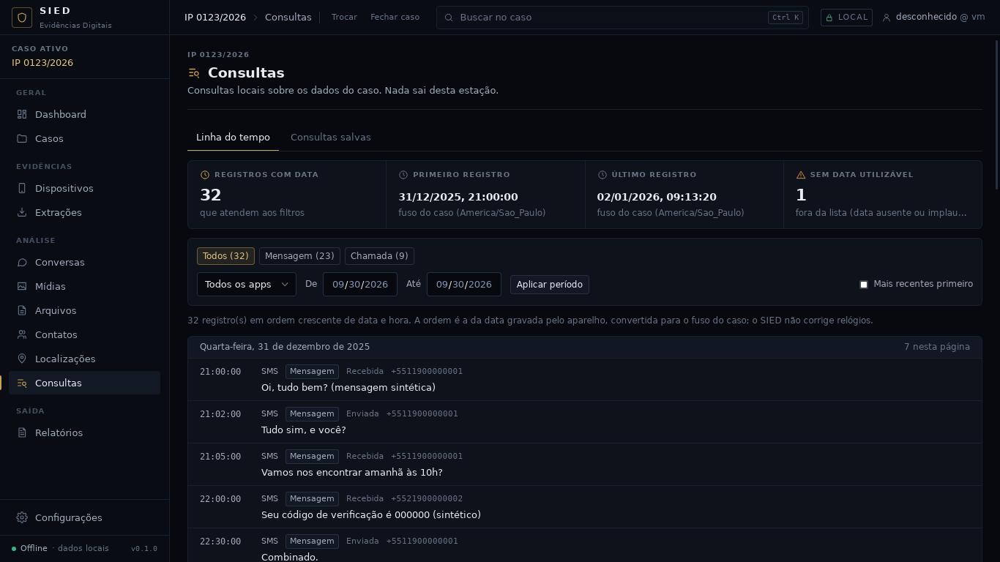

# Checkpoint — Linha do tempo unificada e lista de localizações

Data: 30/09/2026 · Branch `claude/contatos-chamadas-android-z7m48s` (mesmo PR do MMS). Fase
escolhida pela regra do usuário de 30/09 ("continue com suas ideias... apenas construa"): com
mensagens (WhatsApp, SMS, MMS) e chamadas no mesmo banco, o analista precisava ver tudo em uma
ordem só.

Critério: **uma lista cronológica de todos os registros com data do caso (todas as extrações e
apps), com filtros, sem gravar nada e sem esconder o que não tem data.** Atendido e conferido no
app real com a extração sintética `--whatsapp --android`: 32 registros com data (23 mensagens e 9
chamadas), 1 sem data utilizável contado à parte, agrupados por dia no fuso do caso, cada um
abrindo a conversa ou a chamada de origem; a pasta da extração ficou intacta.



## IMPLEMENTADO

- Backend (`crates/sied-armazenamento/src/linha_tempo.rs`, só leitura, sem migração):
  - `linha_do_tempo(filtro, deslocamento, limite)`: registros com `data_hora_ms`, ordem
    crescente (ou decrescente) por data e id, pelo índice `idx_artefato_tempo` já existente;
  - filtros: extração, tipos, app, período (ms UTC, inclusivo) e "só com coordenadas";
  - `resumo_linha_do_tempo(filtro)`: total por tipo (sem o filtro de tipo, para os botões),
    apps (sem o filtro de app), primeira e última data, e quantos registros **sem data
    utilizável** atenderiam ao filtro (ficam fora da lista, mas o analista sabe que existem);
  - o registro "conversa" (cabeçalho da conversa no app, cuja data é a da última mensagem) não
    entra; o resultado reusa `AchadoArtefato` da busca, com a conversa de cada mensagem.
- Comandos Tauri `linha_do_tempo` (limite 1–500) e `resumo_linha_do_tempo`.
- Tela **Consultas → aba "Linha do tempo"**: indicadores (registros com data, primeiro e último
  no fuso do caso, sem data), botões por tipo com contagem, app, extração (quando há mais de
  uma), período, "Mais recentes primeiro", lista agrupada por dia com hora (com segundos), app,
  tipo, sentido, participante e conteúdo; cada linha abre a conversa (com o registro destacado),
  a chamada em Contatos ou a extração. A aba "Consultas salvas" continua indisponível.
- Tela **Localizações**: a mesma lista, fixa em registros com coordenadas, mostrando latitude e
  longitude como lidas. O mapa continua marcado como indisponível (não há mapas locais).
- A busca passou a usar o mesmo destino por registro (`destinoRegistro`).

## TESTES REALIZADOS

| Verificação | Resultado |
|---|---|
| `cargo fmt --check`, `cargo clippy -D warnings` | limpos |
| `cargo test --workspace` | 232 passam, 0 falham, 3 medições ignoradas (+5: 3 ponta a ponta e 2 tipos exportados) |
| `npm run typecheck`, `npm test` (54), `npm run build` | limpos |
| Ponta a ponta `testes/e2e` (roteiro inalterado) | passa; extração intacta |
| Capturas no app real com `--whatsapp --android` | passa; extração intacta |

Testes novos: `crates/sied-armazenamento/tests/linha_tempo.rs` (WhatsApp sintético mais o
registro de chamadas: ordem, sem cabeçalho de conversa, ordem invertida, paginação estável,
filtros de tipo, app, período, coordenadas e extração, resumo por tipo e app, intervalo e sem
data) e `app/src/rotas/LinhaTempo.test.tsx` (agrupamento por dia no fuso, destinos, filtro de
tipo e ordem enviados ao backend, consultas salvas indisponíveis, Localizações só com
coordenadas). Nenhum teste existente foi alterado.

## ARQUIVOS

- Novos: `crates/sied-armazenamento/src/linha_tempo.rs`,
  `crates/sied-armazenamento/tests/linha_tempo.rs`, `app/src/componentes/LinhaTempo.tsx`,
  `app/src/rotas/LinhaTempo.test.tsx`, `app/src/api/tipos/{FiltroLinhaTempo,ResumoLinhaTempo}.ts`,
  `docs/checkpoints/linha-tempo/` (capturas).
- Alterados: `sied-armazenamento/src/{lib,caso,busca}.rs`, `app/src-tauri/src/{comandos,servico,lib}.rs`,
  `app/src/api/{cliente,consultas}.ts`, `app/src/rotas/{PaginasEstruturais,PaginaBusca}.tsx`, `docs/`.

## DECISÕES

1. A linha do tempo fica dentro de **Consultas** (primeira consulta real do módulo) e alimenta
   **Localizações**; a barra lateral continua com 12 módulos.
2. Ordem pela data gravada pelo parser, sem corrigir relógios nem fundir registros; o desempate é
   o id do registro (ordem de gravação), para a paginação ser estável.
3. Registros sem data não são inventados na lista: aparecem só como contagem.

## PROBLEMAS

- Nenhum bloqueio. O primeiro teste de período contou 9 em vez de 8: o cabeçalho de uma conversa
  do WhatsApp tinha a data da última mensagem; ele deixou de entrar na linha do tempo.

## COMO EXECUTAR

```
python3 testes/gerador/extracao_sintetica.py --whatsapp --android <pasta vazia>
cd app && npm run tauri dev
```
Importar a pasta e abrir Consultas (ou Localizações).

## COMO TESTAR

Os mesmos comandos de sempre (`docs/HANDOFF-CODEX.md` §29).

## LIMITAÇÕES

- Paginada de 100 em 100 (sem rolagem virtual); o período é por dia inteiro no fuso do caso.
- Sem mapa; sem exportação da linha do tempo para o relatório (os registros podem virar
  evidência nas telas de origem).
- Horários são os do aparelho (UTC gravado pelo app); o SIED não detecta relógio errado.

## PRÓXIMA FASE

Console de importação em tempo real (`docs/CONTINUIDADE.md` §14.1).
