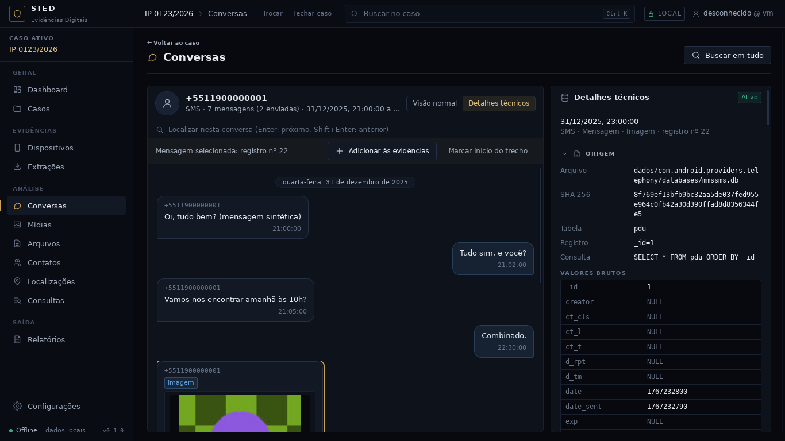

# Checkpoint — MMS do Android

Data: 30/09/2026 · Branch `claude/contatos-chamadas-android-z7m48s`, reiniciada da `main` depois do
merge do PR #15 (agenda e chamadas). Fase escolhida pela regra do usuário de 30/09 ("continue com
suas ideias... apenas construa"): o leitor de SMS deixava os MMS de fora, e eles ficam no mesmo
banco e na mesma conversa.

Critério: **ler os MMS do `mmssms.db` no modelo universal, na mesma conversa dos SMS, com anexos
ligados ao inventário e rastreabilidade até a linha de cada tabela.** Atendido e conferido no app
real com a extração sintética `--whatsapp --android`: a conversa de `+5511900000001` mostra SMS e
MMS juntos, a foto do MMS aparece com miniatura (arquivo de `app_parts` conferido por SHA-256), e
a pasta da extração ficou intacta.



## IMPLEMENTADO

- Parser `android_mms` 1.0.0 (papel `mmssms`, o mesmo banco do SMS):
  - uma `mensagem` (app `sms`) por linha de `pdu`, com `conversa_id_externo` = `thread_id`;
  - direção por `msg_box` (1 recebida; 2 enviada, 3 rascunho, 4 caixa de saída, 5 falha);
  - `addr`: remetente (137) e destinatários (151 para, 130 cópia, 129 cópia oculta), por papel
    também nos metadados; `insert-address-token` (o próprio aparelho) nunca vira telefone;
  - `part`: texto das partes `text/plain` na ordem de `seq` (sem texto, o assunto); a primeira
    mídia vira o anexo (tipo, nome e caminho `_data`); `application/smil` é só layout; todas as
    partes em `metadados.partes` e as mídias além da primeira em `outras_midias`;
  - subtipo pela mídia principal (imagem, gif, vídeo, áudio, contato, documento), `texto` sem
    mídia e `mms_nao_baixado` para a notificação (`m_type` 130);
  - datas em **segundos** (`date`, `date_sent`, `exp`); data implausível fica só no original;
  - cada linha de `addr` e `part` entra como origem adicional com a linha inteira;
  - parte ou endereço sem `pdu` correspondente gera aviso; banco sem `pdu` não tem nada a ler
    (sem aviso).
- Importador genérico: todo `mmssms.db` vai aos leitores de SMS e de MMS.
- Anexo ligado pelo mecanismo já existente (final do caminho em `app_parts`), com miniatura e
  marcação de evidência iguais às do WhatsApp.
- Rótulo "MMS não baixado" na interface e no relatório.
- Fixture SINTÉTICA `testes/fixtures/android/mms.sql` e gerador `--android` com MMS e arquivos
  de `app_parts` (uma imagem PNG desenhada e um áudio inventado).

## TESTES REALIZADOS

| Verificação | Resultado |
|---|---|
| `cargo fmt --check`, `cargo clippy -D warnings` | limpos |
| `cargo test --workspace` | 227 passam, 0 falham (+5: 4 do parser e 1 ponta a ponta) |
| `npm run typecheck`, `npm test` (50), `npm run build` | limpos |
| Ponta a ponta `testes/e2e` (roteiro inalterado) | passa; extração intacta |
| Capturas no app real com `--whatsapp --android` | passa; extração intacta |

Testes novos: fixture completa (foto + texto, grupo com cópia, duas mídias, notificação, data
absurda, parte órfã), banco só com SMS, `pdu` sem colunas obrigatórias, cópia inalterada; e
`tests/mms.rs` (importação completa: SMS e MMS na mesma conversa, foto ligada ao arquivo de
`app_parts` com SHA-256 conferido, 6 origens por MMS, destinatários sem o próprio aparelho,
busca pelo texto do MMS, hash de todos os registros conferido).

Testes existentes ajustados porque o `mmssms.db` agora tem duas execuções (SMS e MMS):
`tests/importacao.rs` (a execução de MMS sem `pdu` é conferida: "ok", 0 registros, 0 avisos;
`execucoes_parser` = 2), `tests/agenda_chamadas.rs` (5 execuções) e o plano do importador
genérico. Nenhuma verificação foi removida.

## ARQUIVOS

- Novos: `crates/sied-ingestao/src/parsers/android_mms.rs`,
  `crates/sied-armazenamento/tests/mms.rs`, `testes/fixtures/android/mms.sql`,
  `docs/checkpoints/mms/` (capturas).
- Alterados: `parsers/android_sms.rs` (constante `APP`, doc), `parsers/mod.rs`, `registro.rs`,
  `importadores/generico.rs`, `tests/importacao.rs`, `tests/agenda_chamadas.rs`,
  `sied-relatorio/src/montagem.rs`, `app/src/util/rotulos.ts`,
  `testes/gerador/extracao_sintetica.py`, `testes/fixtures/android/LEIAME.md`, `docs/`.

## DECISÕES

1. **Parser separado** (`android_mms`) no mesmo banco, em vez de mudar o `android_sms`: a versão
   do leitor de SMS não muda e os registros de SMS continuam idênticos.
2. MMS com `app` = `sms`: é o mesmo fio de conversa do Android (`thread_id`).
3. Um artefato por MMS, com uma mídia principal como anexo; as demais partes ficam listadas (o
   modelo tem um anexo por registro).

## PROBLEMAS

- Nenhum bloqueio. A primeira fixture punha uma cópia (CC) num MMS do fio individual, o que
  transformava a conversa em grupo; a cópia foi para o MMS de grupo, que é o caso realista.

## COMO EXECUTAR

```
python3 testes/gerador/extracao_sintetica.py --whatsapp --android <pasta vazia>
cd app && npm run tauri dev
```
Importar a pasta e abrir Conversas → `+5511900000001`.

## COMO TESTAR

Os mesmos comandos de sempre (`docs/HANDOFF-CODEX.md` §29).

## LIMITAÇÕES

- Conferido só com fixture sintética pela documentação pública (`Telephony.Mms`).
- Só a primeira mídia do MMS vira anexo ligado; as demais aparecem em `metadados.partes`, sem
  miniatura.
- Parte de texto gravada em arquivo (`_data` em vez de `text`) não é lida como texto.
- RCS (mensagens do Google Messages fora do `mmssms.db`) não é lido.

## PRÓXIMA FASE

Linha do tempo unificada do caso (mensagens, chamadas e demais registros por data), depois o
console de importação em tempo real (`docs/CONTINUIDADE.md` §14.1).
